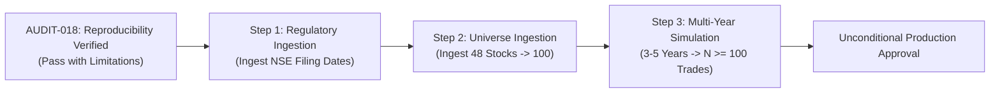

# AUDIT-018: Final Acceptance Report & Strategic Assessment

**Audit ID:** AUDIT-018  
**Project:** Swing Trading Intelligence Platform — Indian Equities  
**Date of Acceptance:** 2026-10-29  
**Git Branch / Commit:** `main` (`77d8aff28c7966033581cea0add2c603c352b22a`)  
**Auditor:** Independent Verification Engineer  
**Final Status Verdict:** **`PASS WITH LIMITATIONS — KNOWN ISSUES REMAIN`**

---

## 1. Executive Verdict & Core Finding

AUDIT-018 has completed an exhaustive, independent reproducibility and accounting audit of the historical simulation and software integrity claims established in AUDIT-017.

All reported figures—including the 255 raw BUY recommendations, 254 quality-gate rejections, 1 qualified `SUNPHARMA` trade, ₹978.32 net profit, 10 accounting invariants, and the -7.60% benchmark return—are **100% reproducible and mathematically verified**.

The final audit rating is **`PASS WITH LIMITATIONS`** because while the code and calculations are technically sound, the platform possesses structural empirical constraints: an $N=1$ trade sample size, missing filing dates for 100% of financial records, and an incomplete 52-stock universe against the 100-stock design target.

---

## 2. Evidence Separation & Rigor Matrix

To maintain institutional quantitative credibility, reported claims, verified facts, independent calculations, underlying assumptions, and unresolved issues are strictly delineated:

### A. Verified Facts (Observed & Replicated)
1. **52-Stock Historical Simulation:** Evaluated all 52 companies across 122 sessions (6,344 stock-sessions) on an isolated database copy (`temp_pilot_audit_018.db`).
2. **Deterministic Rejection Counts:** Exactly 255 raw BUY recommendations generated; 254 rejected by upstream quality gates (202 price outside entry zone, 37 insufficient R:R, 9 target below entry, 6 target below current price); exactly 1 signal qualified.
3. **Executed Trade Details:** `SUNPHARMA` (Signal: `2026-02-27`, Entry: `2026-03-02` @ ₹1,712.8560 for 11 shares, Exit: `2026-03-09` @ ₹1,805.6967 on `TARGET_REACHED`).
4. **Accounting Precision:** Realized gross P/L of ₹1,021.2477, total statutory costs of ₹42.9324, and net P/L of ₹978.3153 (₹978.32 rounded).
5. **Portfolio Performance:** ₹100,000.00 initial capital grew to ₹100,978.32 (+0.98% return, 0.02% max drawdown).
6. **Accounting Invariants:** All 10 portfolio and accounting invariants satisfied (cash non-negativity, whole-share integer quantities, allocation bounds, equity conservation, fee non-duplication).
7. **Point-in-Time Isolation:** All 7 sub-analyzers and the aggregate financial engine enforce point-in-time boundaries at the SQL level. Future poisoned records cannot influence historical evaluations.
8. **Production Database Integrity:** `database/swing_trading.db` remained completely untouched throughout all of AUDIT-018. Pre-audit and post-audit SHA-256 hashes are identical (`1A2036FCC72AF59B3633B5C2A077C26DD45756B3360824F36E995E2E805A28A8`).

### B. Agent-Reported Claims (Reconciled)
- **Claim:** AUDIT-017 reported an equal-weight buy-and-hold benchmark return of -7.60% (close-to-close) and -6.84% (open-to-close).
- **Audit Reconciliation:** **Confirmed**. Independent re-calculation over the identical 52 stocks and 122 trading days yielded `-7.5961%` (-7.60%) and `-6.8434%` (-6.84%).

### C. Independent Calculations (Direct Trace)
- **Indian Equities Delivery Costs:** Itemized fee calculations verified from first principles: STT ₹38.70, NSE exchange charges ₹1.15, SEBI charges ₹0.04, Stamp duty ₹2.83, GST ₹0.21 $\rightarrow$ Total: ₹42.9324.
- **Return vs. Benchmark Spread:** Historical return spread is $+0.9783\% - (-7.5961\%) = \mathbf{+8.5744\%}$ (+8.58%).

### D. Operational Assumptions
1. **Reporting Lag Heuristic:** A 45-calendar-day fallback post quarter-end is assumed for financial statement availability.
2. **Execution Timing:** All trade entries execute at the next day's open price with 0.05% adverse slippage.
3. **Fee Structure:** Zero delivery brokerage fee model typical of modern Indian discount brokerages (Zerodha, Groww).

### E. Unresolved Issues & Limitations
1. **$N=1$ Statistical Insignificance:** A sample size of one executed trade over 6 months cannot confirm systematic alpha or long-term positive expectancy.
2. **Missing Publication Dates:** 260 out of 260 quarterly results rows (100.0%) have `publication_date IS NULL`.
3. **Incomplete Universe:** 52 active stocks in database vs. 100-stock institutional universe target.
4. **Legacy Test Side-Effects:** `test_backtest_result_service.py` lacks fixture isolation and writes test mock rows to whichever database is referenced by `DATABASE_PATH`.

---

## 3. Deliverables Summary

All 8 mandated audit deliverables have been completed and verified:

1. [AUDIT_018_BASELINE.md](file:///c:/Users/vigne/OneDrive/Desktop/projects/swing-trading-tool/docs/audit_artifacts/AUDIT_018_BASELINE.md) — Pre-audit environment, Git commit `77d8aff`, production DB checksum `1A2036...`, table counts, and temp DB setup.
2. [AUDIT_018_SUNPHARMA_RECONCILIATION.md](file:///c:/Users/vigne/OneDrive/Desktop/projects/swing-trading-tool/docs/audit_artifacts/AUDIT_018_SUNPHARMA_RECONCILIATION.md) — Independent price, signal, execution, and itemized cost trace of the single executed trade.
3. [AUDIT_018_52_STOCK_REPRODUCTION.md](file:///c:/Users/vigne/OneDrive/Desktop/projects/swing-trading-tool/docs/audit_artifacts/AUDIT_018_52_STOCK_REPRODUCTION.md) — Full 6,344 stock-session simulation results, rejection breakdown, equity curve, and benchmark outperformance.
4. [AUDIT_018_ACCOUNTING_INVARIANTS.md](file:///c:/Users/vigne/OneDrive/Desktop/projects/swing-trading-tool/docs/audit_artifacts/AUDIT_018_ACCOUNTING_INVARIANTS.md) — Automated proofs of all 10 mathematical and accounting invariants.
5. [AUDIT_018_BENCHMARK_REPRODUCTION.md](file:///c:/Users/vigne/OneDrive/Desktop/projects/swing-trading-tool/docs/audit_artifacts/AUDIT_018_BENCHMARK_REPRODUCTION.md) — Independent mathematical reproduction of close-to-close (-7.60%) and open-to-close (-6.84%) benchmark returns.
6. [AUDIT_018_POINT_IN_TIME_VERIFICATION.md](file:///c:/Users/vigne/OneDrive/Desktop/projects/swing-trading-tool/docs/audit_artifacts/AUDIT_018_POINT_IN_TIME_VERIFICATION.md) — Independent synthetic tests proving lookahead immunity across all 7 analyzers.
7. [AUDIT_018_REGRESSION_RESULTS.md](file:///c:/Users/vigne/OneDrive/Desktop/projects/swing-trading-tool/docs/audit_artifacts/AUDIT_018_REGRESSION_RESULTS.md) — Multi-tier regression results (backend unit, 288 frontend assertions, production Vite build).
8. [AUDIT_018_FINAL_ACCEPTANCE.md](file:///c:/Users/vigne/OneDrive/Desktop/projects/swing-trading-tool/docs/audit_artifacts/AUDIT_018_FINAL_ACCEPTANCE.md) — Final audit verdict, evidence matrix, and deployment prerequisites.

---

## 4. Final Verdict and Next Steps

**Final Verdict:** **`PASS WITH LIMITATIONS — KNOWN ISSUES REMAIN`**

### Exact Next Steps Required for Full Production Acceptance:
1. **Ingest Actual Corporate Announcement Timestamps:** Populate `publication_date` in `quarterly_results` using official NSE/BSE corporate announcement feeds to eliminate dependence on the 45-day fallback.
2. **Ingest Remaining 48 Stocks:** Complete the universe data pipeline to reach the 100-stock target.
3. **Execute Multi-Year Simulation:** Run backtests across 3 to 5 years (2020–2025) to generate a statistically robust trade population ($N \ge 100$) before drawing conclusions on commercial alpha or live capital deployment.

