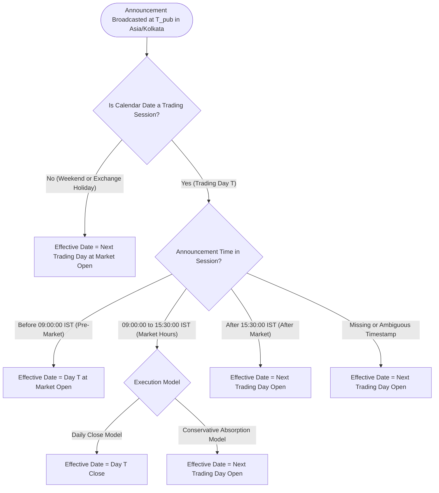
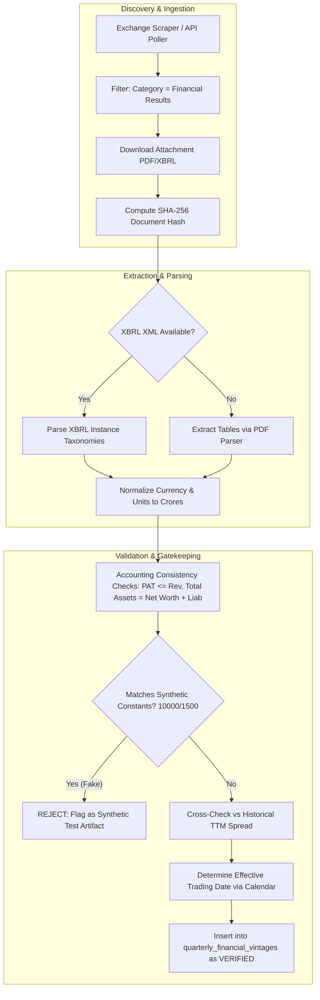

# P2.3 — Historical Financial Vintage Architecture Design

**Target Repository:** `https://github.com/vignesh19807/swing-trading-tool`  
**Current Baseline Commit:** `ecbcbde2e78f03e06575b84240634ba3b5c81239`  
**Execution Environment:** Windows, Python 3.14.7, SQLite  
**Design Phase:** P2.3 Architectural Specification (Read-Only)  
**Status:** `P2.3 ARCHITECTURE COMPLETE — READY FOR REVIEW`  

---

## 1. Executive Summary

Phase P2.3 delivers the comprehensive architectural design for **Historical Financial Vintage and Point-in-Time (PIT) Data Integrity** for the Swing Trading Intelligence Platform.

Audits P2.1 and P2.2 established that the existing `quarterly_results` table is fundamentally incapable of supporting reliable research backtesting:
1. **0% Authentic Data:** 258 of 260 rows contain hardcoded synthetic placeholder numbers (`revenue=10000.0`, `net_profit=1500.0`), and the 2 distinct `INFY` rows are synthetic unit test fixtures.
2. **100% Missing Timestamps:** All 260 rows have `publication_date IS NULL`.
3. **Destructive Overwrite Vulnerability:** The unique constraint on `(company_id, quarter)` enforces a single mutable snapshot per quarter. Any restatement, revision, or corrigendum overwrites original filings in place, introducing forward-looking restatement lookahead bias into historical simulations.

This document specifies the target architecture: an append-only, multi-vintage data store (`quarterly_financial_vintages`), deterministic market-session publication boundary resolution, source document provenance hashing, backward-compatible migration routing, and complete regression test design.

---

## 2. Verified Repository Context & Invariants

### 2.1 Current Database State
* **Production Database (`database/swing_trading.db`):** SHA-256 `1a2036fcc72af59b3633b5c2a077c26dd45756b3360824f36e995e2e805a28a8`.
* **Staging Database (`database/staging_financial_expansion.db`):** SHA-256 `4b5a3479aba5f5176843ef1033c026a543d54914db68cd2169e1ff5552bed465`.
* Both databases contain 52 tracked companies and exactly 260 quarterly rows (`2025-Q1` through `2026-Q1`), all with `publication_date IS NULL`.

### 2.2 Protected Files Invariance
* [`backend/logic/signal_engine.py`](file:///C:/Users/vigne/OneDrive/Desktop/projects/swing-trading-tool/backend/logic/signal_engine.py): Verified present, 0 diffs against HEAD.
* [`backend/logic/trade_quality_engine.py`](file:///C:/Users/vigne/OneDrive/Desktop/projects/swing-trading-tool/backend/logic/trade_quality_engine.py): Verified present, 0 diffs against HEAD.
* [`backend/logic/portfolio_simulator.py`](file:///C:/Users/vigne/OneDrive/Desktop/projects/swing-trading-tool/backend/logic/portfolio_simulator.py): Verified present, 0 diffs against HEAD.
* `backend/logic/strategy_engine.py`: **Verified Non-Existent** (strategy logic is housed across `signal_engine.py`, `trade_quality_engine.py`, and `historical_signal_evaluator.py`).

---

## 3. Proposed Data Model: `quarterly_financial_vintages`

To guarantee that no historical observation is ever overwritten or destroyed, financial filings are modeled as an **immutable, append-only event stream of disclosures**.

### 3.1 Relational Schema Definition
```sql
CREATE TABLE quarterly_financial_vintages (
    id                          INTEGER PRIMARY KEY AUTOINCREMENT,
    company_id                  INTEGER NOT NULL,
    quarter                     TEXT NOT NULL,               -- e.g. '2024-Q2', '2025-Q1'
    period_start_date           TEXT NOT NULL,               -- 'YYYY-MM-DD'
    period_end_date             TEXT NOT NULL,               -- 'YYYY-MM-DD'
    accounting_standard         TEXT NOT NULL DEFAULT 'IND_AS' CHECK(accounting_standard IN ('IND_AS', 'IGAAP')),
    filing_scope                TEXT NOT NULL DEFAULT 'CONSOLIDATED' CHECK(filing_scope IN ('CONSOLIDATED', 'STANDALONE')),
    filing_type                 TEXT NOT NULL CHECK(filing_type IN ('ORIGINAL', 'AMENDED', 'RESTATED', 'AUDITED_FINAL')),
    version_sequence            INTEGER NOT NULL DEFAULT 1,  -- 1 for first filing, 2 for first revision, etc.
    superseded_by_vintage_id    INTEGER,                     -- NULL if active/latest; points to superseding vintage
    
    -- Announcement & Timestamp Semantics
    exchange                    TEXT NOT NULL CHECK(exchange IN ('NSE', 'BSE')),
    exchange_broadcast_id       TEXT NOT NULL,               -- Exchange-issued unique announcement ID
    publication_timestamp       TEXT NOT NULL,               -- ISO-8601: 'YYYY-MM-DD HH:MM:SS' in Asia/Kolkata
    effective_trading_date      TEXT NOT NULL,               -- First trading session information is executable ('YYYY-MM-DD')
    
    -- Reported Income Statement & Balance Sheet Line Items (in INR Crores)
    revenue                     REAL NOT NULL,               -- Revenue from operations
    operating_expenses          REAL,                        -- Operating costs excluding D&A, interest, tax
    operating_profit            REAL,                        -- Operating profit / EBITDA
    net_profit                  REAL NOT NULL,               -- Profit After Tax (PAT)
    eps                         REAL NOT NULL,               -- Basic / Diluted EPS (in INR)
    total_assets                REAL,                        -- Balance sheet total assets
    total_equity                REAL,                        -- Shareholders' equity / net worth
    total_debt                  REAL,                        -- Total short-term + long-term debt
    current_liabilities         REAL,                        -- Current liabilities for capital employed calc
    
    -- Standardized Ratios (Materialized for query performance, audited via source line items)
    roe                         REAL,                        -- Net Profit / Shareholders' Equity
    roce                        REAL,                        -- EBIT / Capital Employed
    debt_equity                 REAL,                        -- Total Debt / Total Equity
    operating_margin            REAL,                        -- Operating Profit / Revenue
    net_margin                  REAL,                        -- Net Profit / Revenue
    
    -- Provenance, Fingerprinting & Auditability
    source_document_url         TEXT NOT NULL,               -- Exchange URL to PDF / XBRL
    source_document_hash        TEXT NOT NULL,               -- SHA-256 fingerprint of original downloaded file
    verification_status         TEXT NOT NULL CHECK(verification_status IN ('VERIFIED', 'PROVISIONAL', 'REJECTED')),
    verification_notes          TEXT,                        -- Reason for status / auditor initials
    created_at                  TEXT DEFAULT CURRENT_TIMESTAMP,
    
    FOREIGN KEY (company_id) REFERENCES companies(id),
    FOREIGN KEY (superseded_by_vintage_id) REFERENCES quarterly_financial_vintages(id),
    
    -- Invariance: Each exchange announcement can only be recorded once
    UNIQUE(exchange, exchange_broadcast_id),
    -- Invariance: A company cannot have duplicate version sequences for the same quarter and scope
    UNIQUE(company_id, quarter, filing_scope, version_sequence)
);

-- Point-in-Time Research Index: Ultra-fast filtering on company, effective date, and quarter
CREATE INDEX idx_vintages_pit_eval 
ON quarterly_financial_vintages(company_id, filing_scope, effective_trading_date, quarter);

CREATE INDEX idx_vintages_doc_hash 
ON quarterly_financial_vintages(source_document_hash);
```

### 3.2 Key Design Choices
1. **Consolidated vs. Standalone Distinction:**  
   In Indian equity markets, conglomerates and holding companies (e.g., Tata Motors, Reliance, L&T) report vastly different figures between Standalone (parent entity) and Consolidated (including global subsidiaries). The schema enforces `filing_scope = 'CONSOLIDATED'` as the primary standard for swing trading valuation, falling back to `'STANDALONE'` only when a company has no operating subsidiaries.
2. **Raw Line Items vs. Derived Ratios:**  
   To prevent rounding distortions and inconsistent third-party ratio definitions, the vintage schema stores **both** raw accounting line items (`revenue`, `net_profit`, `total_debt`, `total_equity`) and materialized standardized ratios. Standardized ratios are computed deterministically at ingestion time and mathematically verified against source line items.
3. **Document SHA-256 Fingerprinting:**  
   Every ingested exchange PDF/XBRL is hashed at download time. This guarantees complete auditability back to official exchange filings and prevents silent re-downloads of altered files.

---

## 4. Point-in-Time (PIT) Query Design

### 4.1 Concept Clarification: The 4 Core Dates
* **Period End Date ($D_{\text{period}}$):** The calendar end of the accounting quarter (e.g. `2024-09-30`). **Never** implies public availability.
* **Publication Timestamp ($T_{\text{pub}}$):** The exact date and second the stock exchange broadcasted the filing to the public (e.g. `2024-10-17 15:45:12 IST`).
* **Effective Trading Date ($D_{\text{eff}}$):** The exact trading day at which a market participant could first execute an order based on the news (e.g. `2024-10-18`).
* **Evaluation Date ($D_{\text{eval}}$):** The historical backtest simulation date (e.g. `2024-10-17`).

### 4.2 Deterministic PIT Resolution Rule
On any historical evaluation date $D_{\text{eval}}$:
1. **Visibility Gate:** Include only filings where $D_{\text{eff}} \le D_{\text{eval}}$ and `verification_status = 'VERIFIED'`.
2. **Version Resolution:** If multiple vintages exist for a given `quarter` (e.g., an original filing and a subsequent corrigendum/restatement), select the vintage with the **highest `version_sequence` whose $D_{\text{eff}} \le D_{\text{eval}}$**.
3. **Future Leakage Barrier:** Any restatement or amended filing whose $D_{\text{eff}} > D_{\text{eval}}$ is completely invisible to the query, ensuring that the backtest sees only what was available at that exact historical moment.

### 4.3 SQLite-Compatible Point-in-Time SQL
```sql
WITH eligible_vintages AS (
    SELECT 
        v.*,
        ROW_NUMBER() OVER (
            PARTITION BY v.quarter 
            ORDER BY v.version_sequence DESC, v.publication_timestamp DESC
        ) AS rank
    FROM quarterly_financial_vintages v
    WHERE v.company_id = :company_id
      AND v.filing_scope = :filing_scope
      AND v.effective_trading_date <= :evaluation_date
      AND v.verification_status = 'VERIFIED'
)
SELECT 
    quarter,
    period_end_date,
    effective_trading_date,
    publication_timestamp,
    filing_type,
    version_sequence,
    revenue,
    net_profit,
    eps,
    roe,
    roce,
    debt_equity,
    operating_margin,
    net_margin,
    source_document_url,
    source_document_hash
FROM eligible_vintages
WHERE rank = 1
ORDER BY period_end_date ASC;
```

---

## 5. Market Calendar and Effective Trading Date Algorithm

### 5.1 Trading Hours & Market Session Cutoffs (NSE/BSE)
* **Pre-Open Session:** 09:00:00 to 09:08:00 IST.
* **Continuous Trading Session:** 09:15:00 to 15:30:00 IST.
* **Closing Auction & Post-Closing:** 15:30:00 to 16:00:00 IST.
* **Market Timezone:** Asia/Kolkata (IST = UTC+05:30).

### 5.2 Deterministic Decision Tree



### 5.3 Formal Policy Definitions
1. **After-Market Filings ($T_{\text{pub}} > \text{15:30:00 IST}$):**  
   The announcement cannot affect Day $T$'s official closing price. $D_{\text{eff}} = \text{NextTradingSession}(T)$.
2. **Weekend & Holiday Filings:**  
   Filings made on Saturday, Sunday, or official exchange holidays map to the immediate next regular trading session at market open.
3. **Ambiguous or Date-Only Timestamps:**  
   If an announcement carries a verified date but lacks exact hour/minute/second stamps, the conservative fallback **must** map to $\text{NextTradingSession}(T)$. Treating it as same-day introduces lookahead bias for after-market releases.
4. **Special Trading Sessions (Muhurat Trading):**  
   Special evening sessions (e.g. Diwali Muhurat trading, typically 18:00 to 19:15) must be explicitly represented in the trading calendar table.

---

## 6. Filing Version & Amendment Lineage

### 6.1 Exchange Announcement Disclosures
Under SEBI LODR Regulation 30 and 33:
* **Original Filing:** Broadcasted under category `Financial Results` with subject `Outcome of Board Meeting` or `Financial Results for Quarter ended [Date]`.
* **Corrigendum / Revision:** Broadcasted under `Corrigendum / Revision in Financial Results`.
* **Audited Annual Consolidation:** Broadcasted in Q4/May incorporating full-year audit rectifications.

### 6.2 Lineage Resolution Logic
1. **Document Matching:** When an announcement is discovered with category `Corrigendum` or `Revision`, the pipeline queries existing vintages for `(company_id, quarter, filing_scope)`.
2. **Version Sequence Increment:** If an existing vintage $V_1$ is found, the new filing is assigned $\text{version\_sequence} = V_1.\text{version\_sequence} + 1$.
3. **Supersession Pointer:** The new vintage $V_2$ is inserted, and $V_1.\text{superseded\_by\_vintage\_id}$ is updated to point to $V_2.\text{id}$.
4. **Duplicate Deduplication (NSE vs. BSE):**  
   Listed companies dual-listed on NSE and BSE submit filings to both exchanges. Often, identical PDF attachments are uploaded with a 2-minute time delta.
   * **Hash Deduplication Rule:** If `source_document_hash` matches an existing vintage for the same `(company_id, quarter)`, the secondary exchange announcement is recorded as an audit reference alias rather than creating a false second vintage version.

---

## 7. Data Provenance & Verification Pipeline



### 7.1 Prevention of Synthetic / Placeholder Data Contamination
To prevent a repeat of the 258 placeholder rows identified in P2.1:
1. **Blacklist Gate:** Ingestion pipelines must strictly reject financial records matching known placeholder values (`revenue = 10000.0`, `net_profit = 1500.0`, `eps = 15.0`, `roe = 0.18`).
2. **Provenance Mandate:** No record may be inserted without a non-null `source_document_url` and verified `source_document_hash`.
3. **Isolation of Unit Test Data:** Unit tests must use mock database fixtures in memory (`:memory:`) or dedicated temporary test databases. Real production/staging databases must never be seeded with arbitrary test constants.

---

## 8. Existing Database Compatibility & Migration Strategy

### 8.1 Current Database (`quarterly_results`) Deprecation Plan
* **Do Not Delete or Overwrite Existing Data Yet:** Retain `quarterly_results` as a legacy read-only snapshot until the new vintage pipeline is fully verified.
* **Phase 1: Dual Schema:** Deploy `quarterly_financial_vintages` in `database/staging_financial_expansion.db`. Ingest real exchange filings into the new vintage table.
* **Phase 2: Database View Compatibility:** Create a backward-compatible view:
  ```sql
  CREATE VIEW quarterly_results_v2 AS
  WITH latest_vintages AS (
      SELECT *,
             ROW_NUMBER() OVER (
                 PARTITION BY company_id, quarter, filing_scope 
                 ORDER BY version_sequence DESC
             ) as rn
      FROM quarterly_financial_vintages
      WHERE verification_status = 'VERIFIED'
  )
  SELECT 
      id, company_id, quarter, revenue, net_profit, eps,
      roe, roce, debt_equity, operating_margin, net_margin,
      effective_trading_date AS publication_date
  FROM latest_vintages
  WHERE rn = 1;
  ```
* **Phase 3: Code Redirection:** Update `backend/data_pipeline/financial_service.py` to query `quarterly_financial_vintages` when `require_verified_publication_date=True`.

---

## 9. Testing Strategy (15 Comprehensive Scenarios)

| Scenario ID | Test Case Name | Input Conditions | Expected Outcome |
| :--- | :--- | :--- | :--- |
| **TC-01** | Pre-Announcement Nullity | $D_{\text{eval}} < D_{\text{eff}}$ for original filing | Query returns empty set; fundamental score returns `INSUFFICIENT_DATA`. |
| **TC-02** | Original Filing Eligibility | $D_{\text{eval}} \ge D_{\text{eff}}$ for original filing | Query returns original filing metrics; valid fundamental score computed. |
| **TC-03** | After-Market Boundary | Announcement at 16:30 on Day $T$ | Ineligible on Day $T$; becomes eligible on Day $T+1$. |
| **TC-04** | Weekend Announcement | Announcement on Saturday 11:00 | Ineligible Saturday/Sunday; becomes eligible Monday morning. |
| **TC-05** | Exchange Holiday | Announcement on Republic Day (Jan 26) | Becomes eligible on Jan 27 (next regular session). |
| **TC-06** | Pre-Restatement Evaluation | $D_{\text{eff(Orig)}} \le D_{\text{eval}} < D_{\text{eff(Restated)}}$ | Query returns **Original** metrics; Restated metrics are completely invisible. |
| **TC-07** | Post-Restatement Evaluation| $D_{\text{eval}} \ge D_{\text{eff(Restated)}}$ | Query returns **Restated** metrics (rank = 1 superseding original). |
| **TC-08** | Multi-Version Lineage | 3 successive revisions filed | Sequential `version_sequence` (1, 2, 3); each query returns highest sequence eligible as of $D_{\text{eval}}$. |
| **TC-09** | Dual-Exchange Deduplication| Same PDF uploaded to NSE & BSE | Second upload detected via `source_document_hash`; single vintage created with dual reference. |
| **TC-10** | Missing Publication Timestamp| Date present, timestamp NULL | Conservative fallback routes to $D_{\text{eff}} = \text{NextTradingDay}(D)$. |
| **TC-11** | Malformed Timestamp Format | Non-ISO string (e.g. 'October 2024') | Validation gate rejects row; status set to `REJECTED`. |
| **TC-12** | Standalone vs. Consolidated| Company reports both standalone & group | Consolidated prioritized; standalone isolated under distinct scope. |
| **TC-13** | Synthetic Value Interception| Row matches 10000.0 / 1500.0 pattern | Ingestion gate flags `REJECTED_SYNTHETIC`; never enters verified pool. |
| **TC-14** | Multi-Quarter Historical TTM | Evaluation across 4 quarters | Correct historical sequence of 4 quarters retrieved without gaps. |
| **TC-15** | Strict-Mode Backtest Invariance| Backtest run with strict PIT | Zero trades executed on unverified or unreleased fundamentals. |

---

## 10. Architecture Decision Record (ADR)

* **Status:** PROPOSED (Ready for review)
* **Decision 1:** Supersede mutable `quarterly_results` with immutable append-only `quarterly_financial_vintages`.
* **Decision 2:** Enforce Consolidated results as the primary analytical standard.
* **Decision 3:** Map after-market and weekend exchange announcements to the next valid market trading session at open.
* **Decision 4:** Materialize both raw accounting line items (for auditability) and standardized ratios (for query performance).
* **Decision 5:** Compute and store SHA-256 hashes of all source disclosure documents.

---

## 11. Final Validation Invariants & Status

1. **Database Checksums Invariant:**
   * `database/swing_trading.db`: `1a2036fcc72af59b3633b5c2a077c26dd45756b3360824f36e995e2e805a28a8` (Verified)
   * `database/staging_financial_expansion.db`: `4b5a3479aba5f5176843ef1033c026a543d54914db68cd2169e1ff5552bed465` (Verified)
2. **Protected Files Untouched:**
   * `signal_engine.py`, `trade_quality_engine.py`, `portfolio_simulator.py` have 0 diffs.
   * `strategy_engine.py` confirmed non-existent.
3. **Zero Migrations, Code Changes, or Commits:** No code modified; only this architectural specification artifact created.

**Final Verdict:** `P2.3 ARCHITECTURE COMPLETE — READY FOR REVIEW`

