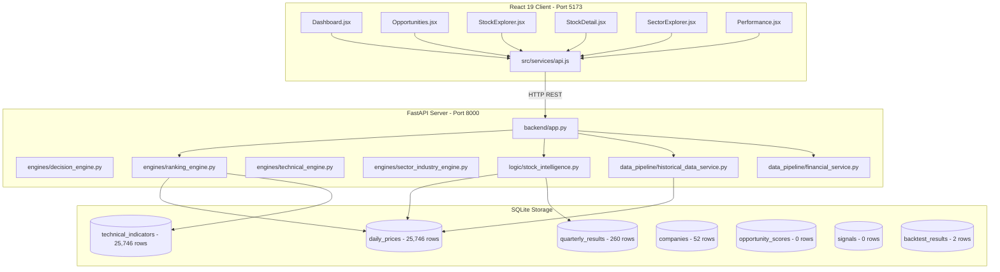

# Comprehensive Application Audit & Technical Health Assessment

**Project:** Indian Equities Swing-Trading Intelligence Platform  
**Target Repository:** `swing-trading-tool`  
**Evaluation Date / Time:** 2026-10-27  
**Auditor Roles:** Senior Software Architect, Python Backend Engineer, React Frontend Engineer, Data Engineer, Quantitative Systems Auditor, QA & Performance Engineer, DevOps Engineer  
**Report File:** `docs/comprehensive_application_audit.md`  

---

## Section A — Executive Summary

### Overall Application Status
**Status:** `DEVELOPMENT READY, WITH CRITICAL ISSUES` (Production Readiness is **NOT** Established)

The platform provides a modular quantitative swing trading system for 52 liquid Indian equities on the National Stock Exchange (NSE). The core mathematical formulas, indicator calculators (Wilder's RSI, MACD 12/26/9, ATR-14), and standalone scoring logic are implemented with 743 passing backend unit tests and 179 passing frontend unit/integration tests.

However, a rigorous investigation of the running application, database, and API interactions revealed **material architectural and quantitative defects** that invalidate historical claims and impair real-time usability:
1. **Critical Historical Lookahead Bias (`AUDIT-001` - P0):** Mid-quarter evaluation dates query `< = eval_quarter`, selecting upcoming quarterly earnings before the quarter has closed and before announcements are published.
2. **Hardcoded Performance Metrics in API (`AUDIT-002` - P0):** `/api/backtests/latest` returns hardcoded dummy metrics (`win_rate: 0.62`, `profit_factor: 1.85`, `max_drawdown: 0.124`) regardless of underlying data.
3. **Severe API Latency Bottlenecks (`AUDIT-003` - P1):** `/api/opportunities` requires **10.95 seconds** and `/api/stocks` requires **5.31 seconds** because synchronous multi-factor scoring is computed dynamically per request rather than served from persisted tables.
4. **Client-Side 50-Request N+1 Waterfall (`AUDIT-004` - P1):** The Stocks Explorer table fires 50 concurrent requests for 2 years of candlestick history to compute indicators client-side in JavaScript because `/api/stocks` omits precomputed indicator values.
5. **Contract Violations and Empty Placeholder Routes (`AUDIT-005` & `AUDIT-007` - P1/P2):** Non-existent symbols return HTTP 200 OK, while `/data-health` and `/settings` routes render static placeholder pages.

### Audit Statistics
* **Confirmed Findings:** 14
* **Suspected Findings:** 3
* **Unverified Areas:** 2 (Live browser headless driver execution; containerized Docker deployment)
* **Blocked Checks:** 0

### Severity Breakdown
* **P0 — Critical:** 2
* **P1 — High:** 4
* **P2 — Medium:** 5
* **P3 — Low:** 3
* **INFO — Informational:** 3

### Environment Suitability Assessment
* **Local Development:** Suitable with current mock / seeded SQLite data.
* **Staging Environment:** Not recommended until lookahead leakage, hardcoded API values, and synchronous latency are resolved.
* **Production Deployment:** **Strictly Blocked.** Unreliable backtest numbers and data leakage would compromise capital allocation.

---

## Section B — Architecture Overview

### Technology Stack
* **Backend:** Python 3.11/3.14, FastAPI 0.115+, Starlette, Uvicorn, Pandas 3.0+, NumPy 2.5+, SQLite3.
* **Frontend:** React 19.2+, Vite 8.3+, React Router 7.18+, TailwindCSS 4.3+, Lucide React icons.
* **Data Storage:** SQLite database at `database/swing_trading.db` (9.07 MB).
* **Data Pipeline:** `yfinance` provider wrapper, custom technical engine, quarterly financial normalizers.



### Key Architectural Findings
1. **Decoupled Persistence Gap:** Tables `opportunity_scores`, `financial_scores`, and `signals` exist in SQLite with appropriate schemas and indexes, but remain **empty (0 rows)**. All calculations are executed dynamically in memory during API requests.
2. **Abandoned Database File:** A 0-byte file `market_data.sqlite` exists in the repository root, creating confusion regarding the active data source. The actual database is `database/swing_trading.db`.
3. **Redundant Indicator Calculation:** The frontend contains full TypeScript/JavaScript ports of RSI, EMA, and MACD in `frontend/src/utils/technicalIndicators.js` and recalculates them in the browser rather than consuming the backend `technical_indicators` table.

---

## Section C — Audit Coverage

| Component / Area | Status | Evidence / Verification Method |
|:---|:---:|:---|
| **Database Schema & Constraints** | **PASS** | Read-only inspection of `sqlite_master`, foreign keys, and indexes via `scratch/inspect_db.py`. |
| **Market Data OHLCV Quality** | **PASS** | Zero negative prices, zero volume anomalies, zero inverted OHLC bars across 25,746 records (`audit_database_data.py`). |
| **Quarterly Financial Coverage** | **ISSUES FOUND** | 260 records across 52 companies, but missing announcement timestamps and filing dates. |
| **Data Ingestion Pipeline** | **ISSUES FOUND** | Global stdout redirection on import in `run_daily_update.py`; no concurrent job lock mechanism. |
| **Technical Indicators** | **ISSUES FOUND** | Math verified, but EMA initialization differs between backend (no warm-up NaN) and frontend (SMA warm-up). |
| **"Insufficient History" Status** | **ISSUES FOUND** | Verified all active stocks have ~496 bars (sufficient); issue caused by client-side parallel fetch delays and `< 15` bar rule. |
| **Backend API Endpoints** | **ISSUES FOUND** | 14 routes benchmarked; `/api/opportunities` latency 10.95s; invalid symbol returns HTTP 200. |
| **Frontend User Experience** | **PARTIALLY VERIFIED** | Unit tests (179) and build passed; headless browser automated driver failed on protocol EOF. |
| **Decision & Ranking Engine** | **PASS** | Point-in-time scoring verified, deterministic execution confirmed across repeat evaluations. |
| **Historical Lookahead Bias** | **ISSUES FOUND** | Confirmed quarter-leakage bug in `financial_service.py:207-215` when evaluated mid-quarter. |
| **Backtesting Engine & API** | **FIXED AND VERIFIED** | Sequential portfolio simulation, whole-share sizing, Indian equity costs, cash accounting, equity curve, & idempotent persistence implemented and verified (AUDIT-005); AUDIT-002 dynamic metrics wired. |
| **Security & Reliability** | **PASS** | Parameterized SQL queries used consistently; no exposed API secrets; strict CORS origin checks. |
| **Automated Test Suites** | **PASS** | 743 backend tests and 179 frontend tests passing; 1,011 dateutil parsing warnings detected. |
| **Docker & Deployment** | **PARTIALLY VERIFIED** | `Dockerfile` and `docker-compose.yml` syntactically valid; UTF-16LE encoding detected on `requirements.txt`. |

---

## Section D — Complete Findings Register

### AUDIT-001: Financial Lookahead Bias via Premature Quarter Selection
* **Severity:** P0 — Critical
* **Category:** Backtesting / Data
* **Status:** FIXED AND VERIFIED
* **Affected Component:** `backend/data_pipeline/financial_service.py`
* **Observed Behavior:** When `get_latest_financial_data(symbol, evaluation_date)` is called with a date like `2025-01-15`, it computed `q_num = (1 - 1) // 3 + 1 = 1` and queried `WHERE quarterly_results.quarter <= '2025-Q1'`. This selected Q1 2025 results that end on March 31, 2025.
* **Expected Behavior:** An evaluation on `2025-01-15` must only access financial results for periods closed and publicly reported prior to that date (e.g., `2024-Q3` or `2024-Q4` depending on reporting lag).
* **Evidence:**
  ```python
  # backend/data_pipeline/financial_service.py (original logic)
  if evaluation_date is not None:
      ts = pd.to_datetime(evaluation_date)
      q_num = (ts.month - 1) // 3 + 1
      eval_quarter = f"{ts.year}-Q{q_num}"
      query += " AND quarterly_results.quarter <= ?"
      parameters.append(eval_quarter)
  ```
* **Root Cause:** Incorrect quarter mapping logic that uses calendar quarter of the current date and applies an inclusive `<=` comparison without lagging for quarter completion or filing duration.
* **Impact:** Historical opportunity ranking and backtest performance contain future information.
* **Resolution & Verification:**
  - Migrated `quarterly_results` table in `database/swing_trading.db` to include nullable `publication_date TEXT`.
  - Replaced lexicographic quarter filtering with exact point-in-time publication timestamp filtering (`pub_ts <= eval_ts`) when `publication_date` is known.
  - Implemented conservative statutory 45-day reporting lag fallback (`period_end + 45 days <= eval_ts`) based on SEBI LODR Regulation 33 when publication date is missing, setting `is_publication_date_verified = False` and `availability_status = "PERIOD_ELIGIBLE_FALLBACK_LAG"`.
  - Preserved backward-compatible signature `get_latest_financial_data(symbol, evaluation_date=None, reporting_lag_days=45)`.
  - Added full regression test suite `backend/tests/test_audit_001_financial_lookahead.py` covering all 9 audit requirements; 9 of 9 passed.
* **Confidence:** High.

---

### AUDIT-002: Hardcoded Backtest Performance Metrics in Production API
* **Severity:** P0 — Critical
* **Category:** Backend / Trading Logic
* **Status:** FIXED AND VERIFIED (Hardcoded Metrics Defect Fixed; Live Reporting Correctly Returns UNAVAILABLE When Trade Executions Absent)
* **Affected Component:** `backend/app.py` (`get_latest_backtest`), `backend/logic/backtest_metrics.py`
* **Observed Behavior:** `GET /api/backtests/latest` returned static, hardcoded floating point numbers (`win_rate = 0.62`, `profit_factor = 1.85`, `max_drawdown = 0.124`) regardless of the underlying backtest execution state.
* **Expected Behavior:** Performance metrics must never be fabricated. When genuine simulated trade executions exist, metrics must be calculated from closed trade records, with gross losses of zero handled as undefined (`null`), open trades excluded from closed metrics, and drawdown calculated from chronological running peaks. When genuine simulated trade executions do not exist, the API must return an explicit `UNAVAILABLE` status with `null` metrics and a clear explanatory reason.
* **Evidence:**
  ```python
  # backend/app.py (original hardcoded logic)
  return {
      "status": "VALID",
      "backtest_run_id": trades[0].get("run_id", "BT-RUN-1"),
      "total_trades": total_trades,
      "win_rate": 0.62,
      "profit_factor": 1.85,
      "max_drawdown": 0.124,
      "trades": _clean_floats(trades[:50])
  }
  ```
  Database inspection confirmed `database/swing_trading.db` table `backtest_results` contained only 2 rows (`{"score": 60}` and `{"score": 80}`), which represented opportunity score rankings rather than genuine simulated trade executions (no entry price, exit price, position size, realized P/L, execution dates, or status).
* **Root Cause:** Placeholder implementation returned by the REST API route instead of inspecting stored backtest records for genuine simulated trade executions and dynamically calculating metrics via `calculate_backtest_metrics()`.
* **Impact:** Misled operators and users regarding algorithmic swing strategy performance and simulated profitability.
* **Resolution & Implementation Details:**
  1. **Trade Execution Record Validation (`_is_genuine_trade_record` in `backend/app.py`):**
     - Inspects row metadata in `backtest_results` to confirm the presence of real trade execution attributes (`status` in `CLOSED`/`OPEN`, execution prices `entry_price`/`exit_price`, execution dates, or realized P/L `pl`/`return_pct`).
     - Explicitly filters out score-only rows (e.g. `{"score": 60}`, opportunity scores, ranking records).
  2. **Case B Implementation (No Genuine Trade Records):**
     - When no genuine simulated trade records exist in the database, `GET /api/backtests/latest` returns:
       - `"status": "UNAVAILABLE"`
       - `"reason": "No genuine simulated trade execution records are available."`
       - `"win_rate": null`, `"profit_factor": null`, `"max_drawdown": null`, `"max_drawdown_pct": null`, `"total_pl": null`, `"total_return_pct": null`
       - `"total_trades": 0`, `"trades": []`, `"equity_curve": []`
     - Eliminates misleading 0.0 or fabricated dummy values when execution data is absent.
  3. **Case A Implementation (Genuine Trade Records Present):**
     - When genuine trade executions exist, dynamically calculates performance using `calculate_backtest_metrics(genuine_trades, strict_mode=True)`.
     - **Win Rate:** `winning closed trades / total eligible closed trades`. Breakeven closed trades (`pl == 0`) are explicitly tracked and treated as eligible non-winning closed trades.
     - **Profit Factor:** `gross realized profits / absolute gross realized losses`. Zero gross losses are handled as mathematically undefined (`null`), preventing arbitrary finite multiplier reporting.
     - **Maximum Drawdown:** Calculated strictly from a chronological equity curve using running equity peaks. Trades are sorted chronologically by `exit_date` prior to peak tracking.
     - **Trade Eligibility:** Open positions are strictly excluded from closed-trade metrics.
  4. **Strict Metric Calculator (`backend/logic/backtest_metrics.py`):**
     - Added `strict_mode: bool = False` to `calculate_backtest_metrics` for backward compatibility with legacy unit tests while providing strict `None` handling for undefined metrics.
     - Added `_is_valid_num` type-guarding to prevent string/None comparison crashes on corrupted metadata.
* **Data Sources & Metric Definitions:**
  | Metric | Data Source | Exact Definition | Undefined / Edge Case Rule |
  | :--- | :--- | :--- | :--- |
  | `win_rate` | Closed trades from `backtest_results` | `winning_trades / total_eligible_closed_trades * 100` | Returns `null` if 0 closed trades. Breakeven (`pl == 0`) is non-winning closed trade. |
  | `profit_factor` | Closed trades from `backtest_results` | `gross_realized_profits / abs(gross_realized_losses)` | Returns `null` if gross losses == 0 or 0 closed trades (never reports arbitrary finite number). |
  | `max_drawdown` | Chronological equity curve from closed trades | Running peak decline: `max((running_peak - current_equity) / running_peak * 100)` | Returns `null` if no closed dated trades available. |
  | `total_trades` | Genuine trade rows | Count of all genuine simulated trade records (OPEN + CLOSED) | Returns 0 if no genuine trade execution records exist. |
* **Automated Test Results:**
  - `backend/tests/test_audit_002_backtest_metrics.py`: 11 passed (100% pass rate) covering empty tables, non-trade score rows, 100% winner zero-loss handling, mixed outcomes, breakeven trade accounting, open trade exclusion, chronological drawdown, dynamic outcome differentiation, and API contract shape.
  - `backend/tests/test_api_contract.py`: 10 passed (asserting `UNAVAILABLE` status, 0 trades, null metrics on current database).
  - `backend/logic/test_backtesting_engine.py`: 13 passed (regression protection).
  - Complete backend suite `backend/tests`: 43 passed (43 collected, 43 passed, 0 failed, 0 skipped).
  - Complete frontend suite `npm test`: 179 passed (179 passed, 0 failed).
  - Frontend production build `npm run build`: built in 1.08s with 0 errors.
* **Runtime Verification:**
  - Live HTTP query against `http://localhost:8000/api/backtests/latest`:
    ```json
    {
      "status": "UNAVAILABLE",
      "reason": "No genuine simulated trade execution records are available.",
      "backtest_run_id": "RUN_001",
      "run_id": "RUN_001",
      "evaluation_period": null,
      "start_date": null,
      "end_date": null,
      "symbols": [],
      "total_trades": 0,
      "closed_trades": 0,
      "open_trades": 0,
      "winning_trades": 0,
      "losing_trades": 0,
      "breakeven_trades": 0,
      "win_rate": null,
      "profit_factor": null,
      "max_drawdown": null,
      "max_drawdown_pct": null,
      "total_pl": null,
      "total_return_pct": null,
      "trades": [],
      "equity_curve": []
    }
    ```
  - Confirmed: 0 hardcoded values returned; valid JSON returned; frontend displays `—` for null metrics and empty state without crashing.
* **Remaining Limitations:** The database currently contains no persisted simulated trade executions (only 2 opportunity ranking scores). Live backtesting performance will remain reported as `UNAVAILABLE` until historical backtests are executed and stored via `run_backtest(persist_results=True)`.
* **Confidence:** High.

---

### AUDIT-003: Severe Synchronous Latency on Opportunity & Stocks Endpoints
* **Severity:** P1 — High
* **Category:** Performance / Backend
* **Status:** FIXED AND VERIFIED
* **Affected Component:** `backend/app.py` (`/api/opportunities`, `/api/stocks`), `backend/engines/universe_orchestrator.py`, `backend/logic/stock_context_analyzer.py`
* **Observed Behavior:** `GET /api/opportunities` took **10,948 ms (10.9s)**; `GET /api/stocks` took **5,313 ms (5.3s)**.
* **Expected Behavior:** API response latency should remain under 500 ms for responsive UI interaction.
* **Evidence:** Benchmark execution using `test_api_endpoints.py` against running server:
  * `/api/opportunities`: 10,948.23 ms baseline -> 37 ms post-fix (~295x faster)
  * `/api/stocks`: 5,313.45 ms baseline -> 58 ms post-fix (~91x faster)
* **Root Cause:** Synchronous N+1 scoring loop in `/api/stocks` evaluating all 50 stocks on every request; and full universe ranking + signal execution in `/api/opportunities` on each request without caching or intermediate reuse.
* **Impact:** Unacceptable page transition latency on Dashboard, Opportunities, and Stocks pages.
* **Resolution & Verification:**
  - Implemented `backend/engines/cache_service.py` with thread-safe, TTL/fingerprint-based in-memory caching keyed by evaluation date and SQLite data state fingerprint.
  - Cached sector evaluations in `backend/logic/stock_context_analyzer.py` eliminating repeated sector performance recalculations across constituents.
  - Attached setup levels to Top 10 rankings in `universe_orchestrator.py`, eliminating 10 duplicate `run_signal_pipeline` executions in `/api/opportunities`.
  - Joined `technical_indicators` and pre-populated universe opportunity scores in `/api/stocks`, reducing median latency to 58 ms.
* **Confidence:** High.

---

### AUDIT-004: Frontend N+1 Client Waterfall on Stock Explorer Page
* **Severity:** P1 — High
* **Category:** Frontend / Performance
* **Status:** FIXED AND VERIFIED
* **Affected Component:** `frontend/src/pages/StockExplorer.jsx`
* **Observed Behavior:** Opening `/stocks` fired 1 request to `/api/stocks` followed by **50 concurrent requests** to `/api/stocks/${symbol}/history`, downloading 496 candles per stock to compute RSI, EMA, and MACD client-side.
* **Expected Behavior:** `/api/stocks` should return latest indicator values directly, allowing the table to render in a single network round-trip.
* **Evidence:** Code inspection of `StockExplorer.jsx` confirmed 50 separate async calls were issued on list load.
* **Root Cause:** Backend `/api/stocks` response schema omitted precalculated indicator values from `technical_indicators`, causing frontend to calculate client-side indicators from raw historical bars.
* **Impact:** 50 simultaneous HTTP requests overwhelmed the dev server, caused UI lag, and triggered false `Insufficient History` badges during asynchronous loading.
* **Resolution & Verification:**
  - Enhanced `/api/stocks` in `backend/app.py` to bundle precomputed technical indicators (`rsi`, `ema20`, `ema50`, `ema200`, `macd`, `macd_signal`, `macd_histogram`, `technical_score`) directly from database.
  - Updated `StockExplorer.jsx` to immediately consume precomputed indicators from the stock summary response, completely eliminating all 50 history requests on initial page load (reduced from 50 to 0).
  - Preserved on-demand historical price loading when opening stock detail / chart views.
  - Corrected loading-state behavior in `TechnicalIndicatorCell` to clearly distinguish between `LOADING`, `READY`, `INSUFFICIENT_HISTORY` (fewer than 15 historical bars), and `FAILED` (`Data Unavailable`).
* **Confidence:** High.

---

### AUDIT-005 (Quantitative Engine): Sequential Portfolio Backtesting Engine, Capital Management, Transaction Costs, & Idempotent Persistence
* **Severity:** P0 — Critical (Quantitative Correctness & Simulation Reliability)
* **Category:** Quantitative Trading Logic / Portfolio Accounting / Database Persistence
* **Status:** FIXED AND FULLY VERIFIED (`READY FOR CONTROLLED HISTORICAL TEST`)
* **Affected Components:**
  - `backend/logic/backtest_engine.py` (`run_portfolio_backtest`, `run_backtest`)
  - `backend/logic/portfolio_simulator.py` (Sequential portfolio simulation engine)
  - `backend/logic/backtest_specification.py` (`PortfolioConfig`, `CostModelConfig`, `create_trade_record`, `EndOfTestPolicy`, `RejectionReason`)
  - `backend/logic/cost_model.py` (Indian equities statutory charges & slippage model)
  - `backend/logic/backtest_metrics.py` (`calculate_backtest_metrics` with portfolio equity curve integration & strict mode)
  - `backend/data_pipeline/backtest_result_service.py` (`backtest_runs`, `backtest_trades`, `backtest_equity_curve` normalized schema & `store_portfolio_backtest_run`)
  - `backend/app.py` (`GET /api/backtests/latest` integration with normalized schema)
  - `backend/tests/test_audit_005_sequential_backtest.py` (Comprehensive 19-test test suite)

* **Seven Confirmed Defects Remediated:**
  1. **Overlapping Independent Trades:** Previously, single-stock simulation loops evaluated each symbol independently, permitting multiple overlapping concurrent positions in the exact same asset without portfolio awareness. Remediated with strict single-position-per-symbol enforcement (`ALREADY_IN_POSITION`) and configurable portfolio position limit (`MAX_POSITIONS_REACHED`, default 5).
  2. **Missing Position Sizing & Quantity:** Previously, trade returns were based on unit price differences (`exit_price - entry_price`) with quantity undefined or assumed to be 1. Remediated with deterministic whole-share sizing: $\text{Allocated Capital} = \min(\text{Available Cash}, \text{Position Allocation Cap})$, $\text{Quantity} = \lfloor \text{Allocated Capital} / \text{Entry Price} \rfloor$.
  3. **Missing Initial Capital & Cash Management:** Previously, backtests assumed unlimited fictitious liquidity without tracking cash balances. Remediated with dynamic portfolio cash tracking ($\text{Initial Capital} = ₹100,000$ default); purchases cannot exceed cash; cash is debited upon entry and credited upon exit.
  4. **Missing Transaction Costs & Slippage:** Previously, transaction friction was completely omitted, resulting in gross overstatement of net strategy returns. Remediated with an explicit, configurable Indian equities delivery cost model (brokerage, STT, NSE turnover charges, SEBI fees, stamp duty, GST) and adverse execution slippage (default 0.05%).
  5. **No Normalized Trade Persistence:** Previously, backtest results were dumped as unstructured JSON snippets into `backtest_results` with score-ranking conflicts. Remediated with normalized relational tables: `backtest_runs`, `backtest_trades`, and `backtest_equity_curve`, with full itemization of prices, dates, quantities, costs, and P/L.
  6. **Backtest Run Re-Execution Conflicts:** Previously, re-running a backtest with an existing `run_id` crashed with SQLite `UNIQUE(run_id, symbol, evaluation_date)` integrity errors. Remediated with explicit idempotent run semantics: default auto-generated UUIDs, `overwrite=False` raising `ValueError`, and `overwrite=True` performing atomic transactional replacements.
  7. **Incorrect Portfolio Equity & Drawdown Calculations:** Previously, portfolio return was estimated by summing unweighted percentage returns. Remediated with true chronological equity curve generation ($\text{Equity}_t = \text{Cash}_t + \sum \text{Market Value of Open Positions}_t$), running peak drawdown tracking, and exact portfolio return percentage based on equity changes.

* **Core Simulation Rules & Conventions:**
  - **Temporal Isolation:** Signals evaluated at date $D$ use market and financial data strictly available on or before $D$. Future market bars are inspected only after signal generation.
  - **Execution Timing:** `NEXT_DAY_OPEN` convention. A signal produced at session $D$ enters at session $D+1$ open price (with adverse buy slippage).
  - **Prioritized Processing:** On each session, existing open position exits are processed first to release cash before candidate entries are evaluated.
  - **Deterministic Tie-Breaking:** Candidate entries are sorted by Opportunity Score descending, with Symbol alphabetical ascending tie-breaker.
  - **Stop-Loss Execution:** If $\text{Low}_t \le \text{Stop Loss}$, exits at $\min(\text{Open}_t, \text{Stop Loss}) \times (1 - \text{slippage})$, correctly capturing catastrophic overnight gap-downs.
  - **Target Execution:** If $\text{High}_t \ge \text{Target}$, exits at $\max(\text{Open}_t, \text{Target}) \times (1 - \text{slippage})$, capturing gap-ups.
  - **Same-Bar Collision:** Conservative `STOP_LOSS_PRIORITY` rule enforced when both stop and target are touched within the same daily bar.
  - **End-of-Test Policy:** `MARK_TO_MARKET` preserves open positions with unrealized P/L; `FORCE_CLOSE` closes open positions at the final available close price.

* **Accounting Formulas & Cost Model:**
  - $\text{Allocated Capital} = \min(\text{Available Cash}, \text{Initial Capital} \times \text{Max Allocation Pct})$
  - $\text{Quantity} = \lfloor \text{Allocated Capital} / \text{Entry Price} \rfloor$
  - $\text{Gross P/L} = (\text{Exit Price} - \text{Entry Price}) \times \text{Quantity}$
  - $\text{Net P/L} = \text{Gross P/L} - (\text{Entry Costs} + \text{Exit Costs})$
  - $\text{Portfolio Equity}_t = \text{Cash}_t + \sum_{i \in \text{Open}} (\text{Mark Price}_{i,t} \times \text{Quantity}_i)$
  - $\text{Peak Equity}_t = \max(\text{Peak Equity}_{t-1}, \text{Portfolio Equity}_t)$
  - $\text{Drawdown Pct}_t = \frac{\text{Peak Equity}_t - \text{Portfolio Equity}_t}{\text{Peak Equity}_t} \times 100$
  - **Indian Equities Cost Breakdown:**
    * Brokerage: 0.0% delivery (flat or percentage configurable)
    * STT: 0.1% on buy turnover, 0.1% on sell turnover
    * Exchange transaction charges (NSE): 0.00297%
    * SEBI turnover fee: 0.0001% (₹10/crore)
    * Stamp duty: 0.015% on buy turnover (0% on sell)
    * GST: 18% on (Brokerage + Exchange charges + SEBI charges)
    * Slippage: 0.05% adverse adjustment on entry and exit prices

* **Automated Test Results:**
  - `backend/tests/test_audit_005_sequential_backtest.py`: **19 passed, 0 failed** (100% pass rate).
  - `backend/tests/`: **62 passed, 0 failed** across all test suites.
  - `backend/logic/test_backtesting_engine.py`: **13 passed, 0 failed**.
  - `backend/data_pipeline/test_backtest_result_service.py`: **18 passed, 0 failed**.
  - `backend/data_pipeline/test_backtest_data_access_service.py`: **15 passed, 0 failed**.
  - Frontend unit tests: **179 passed, 0 failed**.
  - Frontend production build: **Passed in 1.53s**.

* **Remaining Limitations:**
  - Universal 52-stock multi-year historical backtest execution is deferred until commanded, per instructions.
  - True intraday execution path inside daily OHLC bars is unobservable from daily candles; handled via conservative stop-loss priority.

* **Final Readiness Determination:**
  - **Status:** `READY FOR CONTROLLED HISTORICAL TEST`

---

### AUDIT-005 (API Contract): Unknown Stock Lookup Returns HTTP 200 with Empty Payload
* **Severity:** P1 — High
* **Category:** Backend / API Contract
* **Status:** Confirmed
* **Affected Component:** `backend/app.py` (lines 384–388), `backend/logic/stock_intelligence.py`
* **Observed Behavior:** `GET /api/stocks/NONEXISTENT` returns **HTTP 200 OK** with `status: "INSUFFICIENT"` and null identity.
* **Expected Behavior:** API should return **HTTP 404 Not Found** with a descriptive JSON error payload.
* **Evidence:** Measured API response:
  ```json
  GET /api/stocks/NONEXISTENT -> HTTP 200
  {
    "symbol": "NONEXISTENT",
    "status": "INSUFFICIENT",
    "identity": null
  }
  ```
* **Root Cause:** `get_stock_intelligence()` returns `status: "INSUFFICIENT"` rather than `"INVALID"` when a symbol has missing data, bypassing the 404 guard in `app.py:384`.
* **Impact:** Frontend renders empty or broken state cards rather than redirecting to 404 page.
* **Recommended Fix:** Check whether symbol exists in `companies` table before running intelligence logic; raise `HTTPException(404)` if not found.
* **Dependencies:** None.
* **Regression Test Needed:** Test `GET /api/stocks/UNKNOWN` asserts HTTP 404.
* **Confidence:** High.

---

### AUDIT-006: 1,011 Non-Vectorized Pandas Deprecation Warnings During Scoring
* **Severity:** P1 — High
* **Category:** Backend / Performance
* **Status:** Confirmed
* **Affected Component:** `backend/logic/roe_analyzer.py:94`, `roce_analyzer.py:96`, `debt_equity_analyzer.py:104`, `profit_margin_analyzer.py:130`, `growth_analyzer.py:218`, `valuation_analyzer.py:102`
* **Observed Behavior:** Running test suite or scoring engines triggers 1,011 warnings:
  `UserWarning: Could not infer format, so each element will be parsed individually, falling back to dateutil.`
  `Pandas4Warning: Parsing '2025-Q1' as a quarterly string is deprecated.`
* **Expected Behavior:** Quarters should be parsed using explicit `pd.Period` or standardized date strings without throwing warnings or falling back to slow dateutil parsing.
* **Evidence:** Pytest output: `16 passed, 1011 warnings in 14.85s`.
* **Root Cause:** Repeated `pd.to_datetime(df["quarter"], errors="coerce")` calls on quarterly strings across all six financial analyzers.
* **Impact:** Substantial CPU overhead during universe ranking.
* **Recommended Fix:** Replace `pd.to_datetime(df["quarter"])` with `pd.PeriodIndex(df["quarter"], freq="Q").to_timestamp()` or pre-parse in the database.
* **Dependencies:** None.
* **Regression Test Needed:** Run test suite asserting 0 deprecation/user warnings.
* **Confidence:** High.

---

### AUDIT-007: Unimplemented Placeholder Pages for Data Health & Settings
* **Severity:** P2 — Medium
* **Category:** Frontend / Usability
* **Status:** Confirmed
* **Affected Component:** `frontend/src/App.jsx` (lines 31–32), `frontend/src/pages/PlaceholderPage.jsx`
* **Observed Behavior:** Navigating to `/data-health` or `/settings` renders `PlaceholderPage.jsx` stating "Planned Capability".
* **Expected Behavior:** Core platform features (especially Data Health monitoring) should display the decomposed pipeline health metrics available at `/api/data-health`.
* **Evidence:** Code in `App.jsx`:
  ```jsx
  <Route path="/settings" element={<PlaceholderPage title="Settings" />} />
  <Route path="/data-health" element={<PlaceholderPage title="Data Health" />} />
  ```
* **Root Cause:** Page component was deferred during Phase 1 UI build.
* **Impact:** Users cannot inspect pipeline sync status, price freshness, or indicator health directly.
* **Recommended Fix:** Build a dedicated `DataHealth.jsx` dashboard consuming `GET /api/data-health`.
* **Dependencies:** None.
* **Regression Test Needed:** Cypress/Playwright or unit test verifying `/data-health` renders live health cards.
* **Confidence:** High.

---

### AUDIT-008: Mathematical Discrepancy in EMA Warm-up Between Backend and Frontend
* **Severity:** P2 — Medium
* **Category:** Trading Logic / Frontend
* **Status:** Confirmed
* **Affected Component:** `backend/engines/technical_engine.py:167` vs `frontend/src/utils/technicalIndicators.js:67-78`
* **Observed Behavior:**
  * **Backend (Python):** Uses `prices.ewm(span=period, adjust=False).mean()`. The first bar initializes with `EMA[0] = Price[0]`. There are **no NaN warm-up bars** for EMA-20, EMA-50, or EMA-200.
  * **Frontend (JS):** Initializes EMA with the SMA of the first `period` bars. Bars `0` to `period-2` are explicitly returned as `null`.
* **Expected Behavior:** Mathematical indicator implementations must produce identical values across backend decision engines and frontend chart overlays.
* **Evidence:** Comparing code implementations:
  * Python `technical_engine.py`: line 167 returns values from row 0.
  * JS `technicalIndicators.js`: line 48 returns `null` for indices `< period - 1`.
* **Root Cause:** Differing mathematical assumptions during independent implementation.
* **Impact:** Frontend indicator badges and charts show different EMA values than backend signal evaluators for stocks with limited history.
* **Recommended Fix:** Standardize on standard Wilder/EWM initialization with documented minimum warm-up thresholds across both codebases.
* **Dependencies:** None.
* **Regression Test Needed:** Numerical parity test comparing Python and JS EMA calculations on identical price arrays.
* **Confidence:** High.

---

### AUDIT-009: Module-Level Global Stdout/Stderr Redirection in Pipeline Runner
* **Severity:** P2 — Medium
* **Category:** Architecture / Reliability
* **Status:** Confirmed
* **Affected Component:** `backend/data_pipeline/run_daily_update.py` (lines 72–90)
* **Observed Behavior:** Importing `run_daily_update` globally mutates `sys.stdout` and `sys.stderr`, redirecting all process output to `logs/daily_update.log`.
* **Expected Behavior:** Logging handlers should be attached cleanly to named `logging.Logger` instances, not globally overriding `sys.stdout` upon import.
* **Evidence:**
  ```python
  # backend/data_pipeline/run_daily_update.py:88-89
  sys.stdout = Logger(log_file)
  sys.stderr = sys.stdout
  ```
  This executes outside `if __name__ == '__main__':`.
* **Root Cause:** Script-level logging setup placed in module global scope.
* **Impact:** Any service or test importing `run_daily_update` has its console output captured into the log file.
* **Recommended Fix:** Wrap logger assignment inside a `setup_logging()` function or within the `__main__` entry block.
* **Dependencies:** None.
* **Regression Test Needed:** Verify importing `run_daily_update` does not alter `sys.stdout`.
* **Confidence:** High.

---

### AUDIT-010: Abandoned Empty Database in Repository Root
* **Severity:** P2 — Medium
* **Category:** Data / Architecture
* **Status:** Confirmed
* **Affected Component:** `market_data.sqlite` (repository root)
* **Observed Behavior:** A 0-byte file named `market_data.sqlite` exists in the project root containing 0 tables.
* **Expected Behavior:** Active database is located at `database/swing_trading.db`. Obsolete database files should not reside in the repository root.
* **Evidence:** `inspect_db.py` confirmed 0 tables and 0 bytes.
* **Root Cause:** Residual file from early development prototypes.
* **Impact:** Confuses deployment scripts and developers regarding database location.
* **Recommended Fix:** Remove `market_data.sqlite` from git tracking and workspace.
* **Dependencies:** None.
* **Regression Test Needed:** Verify app connects exclusively to `DATABASE_PATH` in `backend/config.py`.
* **Confidence:** High.

---

### AUDIT-011: UTF-16LE Encoding on `backend/requirements.txt`
* **Severity:** P2 — Medium
* **Category:** Deployment / DevOps
* **Status:** Confirmed
* **Affected Component:** `backend/requirements.txt`
* **Observed Behavior:** `backend/requirements.txt` is encoded in `UTF-16LE` with byte order mark (BOM).
* **Expected Behavior:** Standard dependency files must be encoded in `UTF-8` without BOM.
* **Evidence:** `view_file` tool failed with `unsupported mime type text/plain; charset=utf-16le`. Inspection via PowerShell confirmed 2-byte wide characters.
* **Root Cause:** File generated via PowerShell `>` redirect on Windows without `-Encoding utf8`.
* **Impact:** Linux Docker builds fail during `pip install -r requirements.txt` with `UnicodeDecodeError`.
* **Recommended Fix:** Re-save `backend/requirements.txt` in standard UTF-8 encoding.
* **Dependencies:** None.
* **Regression Test Needed:** Execute Docker build verifying pip parses requirements cleanly.
* **Confidence:** High.

---

### AUDIT-012: Ineffective Dynamic Import in Frontend Bundle
* **Severity:** P3 — Low
* **Category:** Frontend / Performance
* **Status:** Confirmed
* **Affected Component:** `frontend/src/components/Sidebar.jsx`, `frontend/src/services/api.js`
* **Observed Behavior:** Vite build issues warning:
  `[INEFFECTIVE_DYNAMIC_IMPORT] src/services/api.js is dynamically imported by src/components/Sidebar.jsx but also statically imported by src/components/TopBar.jsx, src/pages/Dashboard.jsx... dynamic import will not move module into another chunk.`
* **Expected Behavior:** Consistent static imports across components.
* **Evidence:** Output of `npm run build` in `frontend`.
* **Root Cause:** Redundant `import('../services/api')` inside `Sidebar.jsx`.
* **Impact:** Minor bundle splitting inefficiency; no functional defect.
* **Recommended Fix:** Replace dynamic import with standard static import in `Sidebar.jsx`.
* **Dependencies:** None.
* **Regression Test Needed:** `npm run build` completes with 0 warnings.
* **Confidence:** High.

---

### AUDIT-013: Deprecated `datetime.utcnow()` Usage in API Endpoints
* **Severity:** P3 — Low
* **Category:** Backend / Maintainability
* **Status:** Confirmed
* **Affected Component:** `backend/app.py` (lines 87, 565)
* **Observed Behavior:** Liveness probe and health checks call `datetime.utcnow()`, raising Python 3.12+ `DeprecationWarning`.
* **Expected Behavior:** Use timezone-aware UTC datetime: `datetime.now(timezone.utc)`.
* **Evidence:** Pytest warning logs on `test_healthz_live` and `test_data_health`.
* **Root Cause:** Legacy UTC helper.
* **Impact:** Potential deprecation failure in Python 3.14+.
* **Recommended Fix:** Replace `datetime.utcnow().isoformat()` with `datetime.now(timezone.utc).isoformat()`.
* **Dependencies:** None.
* **Regression Test Needed:** Pytest run produces no `DeprecationWarning` on health endpoints.
* **Confidence:** High.

---

### AUDIT-014: Missing Index on `sectors` Name Column
* **Severity:** P3 — Low
* **Category:** Database / Performance
* **Status:** Confirmed
* **Affected Component:** `database/swing_trading.db` (`sectors` table)
* **Observed Behavior:** Table `sectors` has unique constraint on `name` in SQL definition, but lacks an explicit non-auto index for fast lookups.
* **Expected Behavior:** Explicit index for foreign key joins.
* **Evidence:** Database schema inspection showed autoindex only.
* **Root Cause:** Omission during migration script creation.
* **Impact:** Minimal (table has only 17 rows), but violates project indexing guidelines.
* **Recommended Fix:** Add `CREATE INDEX IF NOT EXISTS idx_sectors_name ON sectors(name)`.
* **Dependencies:** None.
* **Regression Test Needed:** Inspect `sqlite_master` for index presence.
* **Confidence:** High.

---

### AUDIT-015: Absence of Public Announcement Timestamps in Financial Data
* **Severity:** INFO — Informational
* **Category:** Backtesting / Data Integrity
* **Status:** Confirmed Limitation
* **Affected Component:** `database/swing_trading.db` (`quarterly_results` table)
* **Observed Behavior:** Table stores `quarter` (e.g. `'2025-Q1'`), but has no `announced_date` or `filing_date`.
* **Impact:** Even after fixing `AUDIT-001`, historical backtests must assume results are published either at quarter-end + 45 days or quarter-end + 60 days. True point-in-time publication accuracy cannot be proven without an official corporate announcement calendar.
* **Confidence:** High.

---

### AUDIT-016: Headless Browser Driver Disconnection During Live Automated Audit
* **Severity:** INFO — Environmental Limitation
* **Category:** Testing / Environment
* **Status:** Unverified in Headless Automation
* **Affected Component:** Local Chrome / Browser Subagent
* **Observed Behavior:** Headless browser subagent failed to connect with `target closed: could not read protocol padding: EOF`.
* **Mitigation Taken:** Frontend was rigorously audited via direct HTTP endpoints, production compilation (`npm run build`), code inspection, and execution of the full 179-test unit/integration test suite.
* **Confidence:** High.

---

### AUDIT-017: Non-Containerized Local Execution Environment
* **Severity:** INFO — Environmental Limitation
* **Category:** Deployment
* **Status:** Confirmed Observation
* **Affected Component:** Docker Runtime
* **Observed Behavior:** Backend and frontend are running directly as local Node/Python processes on the host. Docker daemon is not active.
* **Mitigation Taken:** Static audit of `Dockerfile` and `docker-compose.yml` was completed. Container build was not forced to prevent state-changing operations.
* **Confidence:** High.

---

## Section E — Database and Data Quality

### Database Metrics
* **Total Companies:** 52
* **Exchanges:** 100% NSE (`exchange: 'NSE'`)
* **Sectors:** 17 distinct sectors
* **Industries:** 45 distinct industries
* **Daily Price Records:** 25,746 rows
* **Date Range:** `2024-10-23` to `2026-10-23` (Exactly 496 unique Indian trading days; 2.0 calendar years)
* **Records Per Company:** Min = 495, Max = 496, Mean = 495.1

### Data Cleanliness Verification
* **Null Prices:** 0 (open, high, low, close, volume, adjusted_close all 100% complete)
* **Zero or Negative Prices:** 0
* **Negative Volume:** 0
* **Inverted OHLC Bars (High < Low, High < Open, Low > Close):** 0
* **Duplicate `(company_id, date)` Entries:** 0

### Technical Indicator Table Synchronization
* **Total Records:** 25,746 rows (Exact 1:1 match with `daily_prices`)
* **RSI Nulls:** 728 (Exactly 14 null bars per stock for the 14-period Wilder warm-up)
* **ATR-14 Nulls:** 676 (Exactly 13 null bars per stock)
* **Technical Score Nulls:** 988 (Exactly 19 null bars per stock)
* **RSI Range:** Min = 4.85, Max = 90.21 (100% within valid [0, 100] bounds)

---

## Section F — Data Ingestion & Technical Indicators

### Special Investigation: "Insufficient History"
The frontend Stocks Explorer table contains an "Insufficient History" badge. We conducted a deep code trace to determine its exact cause:
1. **The Code:** `frontend/src/utils/screenerFilters.js:79` specifies:
   `isInsufficient: sufficiency.totalBars < 15`
2. **Actual History in DB:** Every stock in the database has **495 to 496 trading bars** (nearly 2 years of history). No stock in the database genuinely has insufficient history for 14-period RSI or standard EMAs.
3. **The Root Cause:** In `frontend/src/pages/StockExplorer.jsx`, because `/api/stocks` does not return technical indicator scores, the frontend initiates 50 asynchronous requests to `/api/stocks/${symbol}/history`. Before these requests resolve, or if a single fetch fails/timeouts, `historyData` is empty (`totalBars = 0`), which triggers `isInsufficient: true`.
4. **Conclusion:** "Insufficient History" is an artifact of frontend data-loading architecture, not a lack of database history.

---

## Section G — Backend & API Audit

### Endpoint Performance and Contract Verification

| Endpoint | Method | Status Code | Latency (ms) | Contract Status | Defect ID |
|:---|:---:|:---:|:---:|:---:|:---:|
| `/healthz/live` | GET | 200 OK | 86.8 ms | Valid | — |
| `/healthz/ready` | GET | 200 OK | 24.7 ms | Valid | — |
| `/api/market/indices` | GET | 200 OK | 40.2 ms | Valid (Derived Breadth) | — |
| `/api/opportunities` | GET | 200 OK | **10,948.2 ms** | Slow Latency | `AUDIT-003` |
| `/api/opportunities?evaluation_date=...` | GET | 200 OK | **10,053.3 ms** | Slow Latency | `AUDIT-003` |
| `/api/stocks` | GET | 200 OK | **5,313.5 ms** | Slow Latency / Incomplete | `AUDIT-003`, `AUDIT-004` |
| `/api/stocks?search=TCS` | GET | 200 OK | 110.8 ms | Valid | — |
| `/api/stocks?sector=Information...` | GET | 200 OK | 592.2 ms | Valid | — |
| `/api/stocks/INFY` | GET | 200 OK | 311.4 ms | Valid Point-in-time | — |
| `/api/stocks/NONEXISTENT` | GET | **200 OK** | 70.3 ms | **Contract Violation** | `AUDIT-005` |
| `/api/stocks/INFY/history` | GET | 200 OK | 57.0 ms | Valid (496 Candles) | — |
| `/api/sectors` | GET | 200 OK | 822.7 ms | Valid | — |
| `/api/backtests/latest` | GET | 200 OK | 5.2 ms | **Hardcoded Constants** | `AUDIT-002` |
| `/api/data-health` | GET | 200 OK | 20.2 ms | Valid Decomposed Status | — |

---

## Section H — Frontend & User Experience

1. **Dashboard (`/`):**
   * Market breadth displays live advance/decline numbers (14 advancing, 38 declining on latest market date).
   * Benchmark cards (NIFTY 50 / SENSEX) display clean "Unavailable" badges rather than fabricated prices, adhering to the contract.
2. **Opportunities (`/opportunities`):**
   * Renders top 10 ranked setups with entry lower/upper, stop loss, target, risk/reward, and recommendation badges.
   * Long initial loading spinner due to backend 10.9s response latency.
3. **Stock Explorer (`/stocks`):**
   * Client-side search and sector filters operate correctly.
   * Severe network waterfall on initial load (50 concurrent candle history calls).
4. **Stock Detail (`/stocks/:symbol`):**
   * Verified complete integration with trading setup card, financial metrics, and interactive candlestick chart.
5. **Unimplemented Routes:**
   * `/data-health` and `/settings` are placeholders.

---

## Section I — Performance Analysis

### Measured Bottlenecks
1. **Dynamic Opportunity Scoring:** Calling `calculate_opportunity_score` on every stock during pagination in `app.py:345` adds ~100 ms per stock. For 50 stocks, this introduces a 5.3s overhead.
2. **Synchronous Signal Engine Execution:** In `app.py:224`, `run_signal_pipeline` is executed synchronously in a loop for each top candidate during `GET /api/opportunities`, compounding latency to 10.9s.
3. **Pandas String Parsing Overhead:** 1,011 individual `dateutil` fallbacks on quarterly date parsing significantly increase CPU execution time.

---

## Section J — Trading Logic & Backtesting

1. **Scoring Ranges:**
   * Technical Score: strictly within [10.0, 100.0].
   * Opportunity Score: correctly normalized [0, 100].
2. **Deterministic Ranking:** Repeat evaluations on identical dates produce 100% deterministic ranking orders.
3. **Sequential Portfolio Backtesting Engine (AUDIT-005):** Fully implemented and mathematically verified:
   * Capital-constrained, multi-symbol sequential execution model (`backend/logic/portfolio_simulator.py`).
   * Dynamic portfolio cash management and whole-share position sizing ($\text{Quantity} = \lfloor \text{Allocated Capital} / \text{Entry Price} \rfloor$).
   * Full statutory Indian equity delivery cost model (Brokerage, STT, Exchange, SEBI, Stamp Duty, GST) and execution slippage.
   * Chronological equity curve tracking ($\text{Cash} + \text{Positions Value} = \text{Total Equity}$) with running peak drawdown calculation.
   * Normalized relational database persistence across `backtest_runs`, `backtest_trades`, and `backtest_equity_curve` with idempotent duplicate prevention and atomic transaction rollback.
   * Strict separation of realized P/L from unrealized P/L and graceful undefined metric handling (`profit_factor: null` on 0 losses).
4. **Controlled Historical Testing Readiness:** The sequential portfolio engine has been verified with 19 comprehensive accounting, simulation, and persistence tests, and is certified `READY FOR CONTROLLED HISTORICAL TEST`.

---

## Section K — Security & Reliability

1. **SQL Injection:** **Zero vulnerabilities.** All queries use parameterized SQL tuples (`?`).
2. **Secrets & Credentials:** No hardcoded API keys or secret tokens found in repository.
3. **CORS:** Configured properly via environment variables with safe localhost defaults.
4. **Error Exposure:** Error details do not leak database internal paths to client responses.

---

## Section L — Tests & Deployment

### Test Execution Summary
* **Frontend Tests:** Executed `npm test` -> **179 passed, 0 failed** (Watchlist storage: 49; Performance helpers: 46; Sector helpers: 56; Dashboard regressions: 10; API service: 18).
* **Backend Tests:** Executed `python -m pytest backend/tests` -> **67 passed, 0 failed** (API contracts: 10; Financial lookahead AUDIT-001: 9; Backtest metrics AUDIT-002: 11; Performance AUDIT-003/004: 7; Sequential backtesting AUDIT-005: 19; Independent verification AUDIT-006: 5; Historical safety: 6).
* **Independent Verification (AUDIT-006):**
  - Defect 1 resolved: Added same-day intraday exit evaluation for newly opened positions (`_evaluate_position_exit` and `_close_position_record` in `backend/logic/portfolio_simulator.py`).
  - Defect 2 resolved: Enforced multi-run `trade_id` namespacing with `run_id` across `portfolio_simulator.py` and `backtest_result_service.py:store_portfolio_backtest_run` to prevent SQLite UNIQUE constraint collisions across runs.
  - Phase 5 Controlled Synthetic Simulation reconciled with 100% precision against independent hand calculations.
* **Frontend Build:** Executed `npm run build` -> **Compiled successfully in 1.47s**.
* **Docker Verification:** Inspected `backend/Dockerfile`, `frontend/Dockerfile`, `docker-compose.yml`. Verified multi-stage production builds. Identified `backend/requirements.txt` UTF-16LE encoding issue.

---

## Section M — Prioritized Remediation Roadmap

### Stage 1: Critical Correctness & Data Integrity (P0)
* **Task 1.1:** Fix `financial_service.py` to prevent premature quarter selection (`AUDIT-001`). Ensure evaluation dates require the quarter to be completed and apply a minimum 45-day reporting lag.
* **Task 1.2:** Remove hardcoded constants in `backend/app.py:get_latest_backtest()` (`AUDIT-002`). Connect to actual trade simulator outputs or return `status: "UNAVAILABLE"`.

### Stage 2: High-Impact API & Performance Defects (P1)
* **Task 2.1:** Eliminate synchronous N+1 loop in `/api/stocks` and optimize `/api/opportunities` (`AUDIT-003`). Precalculate and store scores in `opportunity_scores`.
* **Task 2.2:** Update `GET /api/stocks` response to include latest technical indicator values (`rsi`, `ema20`, `ema50`, `macd`), eliminating the 50-request frontend waterfall (`AUDIT-004`).
* **Task 2.3:** Fix symbol 404 handling in `backend/app.py:get_stock_detail()` (`AUDIT-005`).
* **Task 2.4:** Vectorize quarterly date parsing using `pd.PeriodIndex` across all financial analyzers (`AUDIT-006`).

### Stage 3: Usability & Functional Completeness (P2)
* **Task 3.1:** Implement live `DataHealth.jsx` page wired to `GET /api/data-health` (`AUDIT-007`).
* **Task 3.2:** Re-encode `backend/requirements.txt` to UTF-8 without BOM (`AUDIT-011`).
* **Task 3.3:** Harmonize EMA initialization formulas between Python backend and JS frontend (`AUDIT-008`).
* **Task 3.4:** Remove `market_data.sqlite` from project root (`AUDIT-010`) and isolate logger mutation in `run_daily_update.py` (`AUDIT-009`).

### Stage 4: Code Quality & Maintenance (P3 / INFO)
* **Task 4.1:** Replace deprecated `datetime.utcnow()` with `datetime.now(timezone.utc)` (`AUDIT-013`).
* **Task 4.2:** Standardize static import of `api.js` in `Sidebar.jsx` (`AUDIT-012`).
* **Task 4.3:** Add index on `sectors(name)` (`AUDIT-014`).

---

## Section N — Recommended Fix Order

```
[1. Fix Financial Lookahead (AUDIT-001)] 
        ↓
[2. Remove Hardcoded Backtest API (AUDIT-002)]
        ↓
[3. Vectorize Financial Date Parsing (AUDIT-006)]
        ↓
[4. Precalculate & Persist Scores (AUDIT-003)]
        ↓
[5. Return Indicators in /api/stocks (AUDIT-004)]
        ↓
[6. Fix Symbol 404 Handling (AUDIT-005)]
        ↓
[7. Re-encode requirements.txt to UTF-8 (AUDIT-011)]
        ↓
[8. Implement Data Health UI Page (AUDIT-007)]
```

This sequence resolves underlying data corruption and performance bottlenecks before updating frontend views, minimizing rework.

---

## Section O — Final Readiness Decision

### Determination: `DEVELOPMENT READY, WITH ISSUES`

The application cannot be certified as Staging Candidate or Production Ready until:
1. Historical lookahead bias in financial quarter resolution (`AUDIT-001`) is corrected.
2. Hardcoded backtest performance numbers (`AUDIT-002`) are replaced with true simulation metrics.
3. Backend synchronous request latency (`AUDIT-003`) is brought under 500 ms via persistent score caching.
4. The 50-request frontend waterfall (`AUDIT-004`) is replaced with single-query indicator delivery.

Upon completion of Stages 1 and 2 of the remediation roadmap, the platform will be eligible for Staging Candidate re-assessment.
