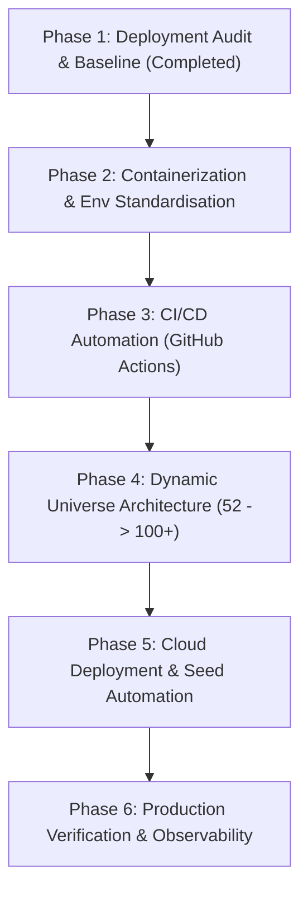

# PHASE 1: REPOSITORY DEPLOYMENT AUDIT
## Swing Trading Intelligence Platform
**Deployment Architecture, CI/CD Automation, Dynamic Universe & Production Readiness**

- **Date:** 2026-11-06
- **Auditor Role:** Senior DevOps Engineer, Cloud Architect, Backend Engineer & Database Specialist
- **Current Project Branch:** `main`
- **Remote Origin:** `https://github.com/vignesh19807/swing-trading-tool.git`
- **Production Database Invariant:** `database/swing_trading.db` (SHA-256 Verified, Untouched, Read-Only)
- **Scope:** Complete repository inspection prior to cloud deployment and continuous development automation.

---

## 1. EXECUTIVE SUMMARY & READINESS SCORE

The Swing Trading Intelligence Platform is an advanced algorithmic stock intelligence application combining deterministic technical analysis, point-in-time financial statement analysis, sector rotation models, and automated backtesting for the Indian equity market.

The platform's core algorithmic engines and frontend UI are mature, well-tested, and functional. However, the repository was built primarily for local workstation execution. Preparing it for continuous cloud deployment requires resolving architectural gaps in **database persistence**, **environment configuration**, **container definitions**, **dynamic universe ingestion**, and **CI/CD automation**.

### Overall Deployment Readiness Score: 6.8 / 10

| Component | Readiness Score | Status | Key Strengths | Critical Gaps |
|:---|:---:|:---:|:---|:---|
| **Frontend (React 19 + Vite 8)** | **8.5 / 10** | Production-Ready | Clean build (1.59s), robust API gateway (`api.js`), mock/real modes, 143 passing tests | Hardcoded check throws error if `VITE_API_BASE_URL` is empty string (breaks same-origin proxy) |
| **Backend API (FastAPI + Uvicorn)** | **7.5 / 10** | Functional | Clean REST contract, 10 GET endpoints, `/healthz` probes, SPA static fallback built-in | `backend/requirements.txt` is UTF-16LE and missing FastAPI/Uvicorn; 15+ files hardcode DB paths |
| **Database & Persistence** | **4.5 / 10** | High Risk | 25,746 daily prices, 260 quarterly results, full indices & classifications intact | `*.db` is gitignored; cloud deploys start with 0 bytes (503 crash); needs persistent disk & seed |
| **Stock Universe Scalability** | **6.0 / 10** | Partially Ready | API layer (`app.py`, `orchestrator`) queries `companies` dynamically ($O(N)$) | Data ingestion runner (`load_stock_data.py`) is hardcoded to static 52-stock list in `stock_universe.py` |
| **Data Pipeline & Automation** | **5.0 / 10** | Workstation-Bound | Complete daily update runner exists (`run_daily_update.py`) with failure logging | Scheduler (`setup_scheduler.py`) uses Windows `schtasks.exe`; no cloud cron or headless worker |
| **CI/CD & GitHub Automation** | **2.0 / 10** | Unconfigured | 1,059 pytest tests + 143 frontend tests exist and pass locally | `.github/workflows/` does not exist; zero CI/CD pipelines, no automated tests on push/PR |
| **Security & Operations** | **7.0 / 10** | Moderate | Zero mutating HTTP routes (read-only query API), CORS env var, non-root user in Dockerfile | No API token authentication; CORS origins must be explicit for production domains |

---

## 2. COMPREHENSIVE FRONTEND AUDIT

### 2.1 Technology Stack & Build Health
- **Framework & Tooling:** React 19.2.8, Vite 8.3.0, TypeScript 5.7 (type declarations installed), Tailwind CSS v4.1.18, Lucide React 1.16.0, Recharts 3.8.1.
- **Build Execution:** `npm --prefix frontend run build` was executed and completed in **1.59s** with zero errors.
- **Asset Distribution:**
  - `dist/index.html`: 0.95 kB
  - `dist/assets/vendor-react-*.js`: 188.08 kB (gzip: 59.98 kB)
  - `dist/assets/vendor-icons-*.js`: 19.78 kB (gzip: 4.88 kB)
  - `dist/assets/index-*.js`: 268.04 kB (gzip: 75.32 kB)
  - `dist/assets/index-*.css`: 35.53 kB (gzip: 7.74 kB)
- **Vite Configuration (`frontend/vite.config.js`):**
  - Configures manual code-splitting chunks (`vendor-react`, `vendor-icons`, `vendor`).
  - Sets up development reverse-proxy: `/api` $\rightarrow$ `http://localhost:8000`.
  - Non-critical warning noted: `[INEFFECTIVE_DYNAMIC_IMPORT] src/services/api.js is dynamically imported by Sidebar.jsx but statically imported elsewhere`. (Harmless optimization notice).

### 2.2 Client Architecture & Service Layer
- **Central API Service (`frontend/src/services/api.js`):**
  - Serves as the centralized HTTP gateway. Enforces strict architectural rule: components never invoke `fetch()` directly.
  - Supports dual modes: `VITE_USE_MOCK_DATA="true"` (loads offline fixture datasets) and real API mode (dispatches requests to backend).
- **Identified Front-End Blocker / Edge Case:**
  In `frontend/src/services/api.js` (lines 52–54):
  ```javascript
  if (!useMock && !baseUrl) {
    throw new Error("Configuration Error: VITE_API_BASE_URL is missing. Real API mode requires this environment variable.");
  }
  ```
  *Issue:* In a unified deployment (where the frontend is served from the same domain as the backend, e.g., `/api/opportunities`) or behind an Nginx reverse proxy where relative paths `/api` should be used, an empty `VITE_API_BASE_URL` causes the frontend to crash with a configuration error.
  *Remedy:* For detached deployments (Vercel $\rightarrow$ Render), `VITE_API_BASE_URL=https://your-backend.onrender.com` must be explicitly defined in build environment variables. For unified reverse-proxy deployments, `api.js` should permit relative paths if configured.

### 2.3 Frontend Test Suite Health
- Executed `npm --prefix frontend test`: **143 tests passed (100% pass rate)**.
  - EMA Calculations (9/9 pass)
  - RSI Calculations (10/10 pass)
  - MACD Calculations (14/14 pass)
  - Educational Classifications (7/7 pass)
  - Screener Filter & Technical Strategy Filters (30/30 pass)
  - Sector Normalization & Sorting (56/56 pass)
  - Dashboard Regressions (10/10 pass)
  - API Service Layer Guards & Fixtures (18/18 pass)

---

## 3. COMPREHENSIVE BACKEND AUDIT

### 3.1 Framework & API Layer
- **Framework:** FastAPI 0.162.0 running on Uvicorn 0.54.0.
- **Python Runtime:** Local workstation is Python 3.14.7; Dockerfile specifies `python:3.11-slim`.
- **Contract Endpoints (`backend/app.py`):**
  - `GET /healthz/live`: Process liveness probe.
  - `GET /healthz/ready`: Database connectivity & company count readiness probe (fails if DB absent or `companies` count is 0).
  - `GET /api/market/indices`: Market breadth (advancing/declining) and benchmark index status.
  - `GET /api/opportunities`: Ranked swing trading setups with entry, stop-loss, target, risk-reward ratios.
  - `GET /api/stocks`: Paginated stock universe with classification, latest prices, and precomputed technicals.
  - `GET /api/stocks/{symbol}`: In-depth stock intelligence report (fundamentals, technicals, setup, risk).
  - `GET /api/stocks/{symbol}/history`: Full OHLCV daily price history.
  - `GET /api/sectors`: Sector performance rankings, relative strength vs benchmark, constituent heatmaps.
  - `GET /api/backtests/latest`: Backtest performance equity curve, win-rate, profit factor, trades list.
  - `GET /api/data-health`: Comprehensive data pipeline integrity status.
  - `GET /{full_path:path}`: Production SPA static fallback (serves `frontend/dist` if built).
- **Mutating Operations:** Exactly **0 POST, PUT, PATCH, or DELETE routes** exist in `backend/app.py`. The API is exclusively read-only, which simplifies cloud security and eliminates unauthorized external mutation risks.

### 3.2 Backend Dependency & Packaging Audit
- **Critical Packaging Defect (`backend/requirements.txt`):**
  1. `backend/requirements.txt` is encoded as **UTF-16LE** (Windows Unicode). Standard Linux Docker container builds (`pip install -r requirements.txt`) fail on UTF-16LE unless explicitly transcoded to UTF-8.
  2. `backend/requirements.txt` only lists 25 sub-packages (numpy, pandas, yfinance, peewee, etc.) and **omits core production server dependencies**: `fastapi`, `uvicorn`, `pydantic`, `httpx`, `pytest`.
  3. `backend/Dockerfile` works around this locally by appending:
     `RUN pip install --no-cache-dir fastapi uvicorn[standard] httpx`
     This violates twelve-factor app principles and causes non-reproducible dependency builds.

### 3.3 Path Hardcoding Across Data Pipeline Services
- In `backend/config.py`:
  `DATABASE_PATH = Path(os.getenv("DATABASE_PATH", str(DATABASE_DIR / "swing_trading.db")))`
- However, an audit of the Python codebase revealed **15+ service files** that do not import `DATABASE_PATH` from `backend.config`, but instead independently compute:
  `DATABASE_PATH = PROJECT_ROOT / "database" / "swing_trading.db"`
  - Examples: `classification_service.py`, `data_service.py`, `financial_service.py`, `peer_group_service.py`, `technical_indicator_service.py`, `opportunity_service.py`.
- *Impact on Docker/Cloud Deployments:* If `DATABASE_PATH=/data/swing_trading.db` is set via environment variable in a cloud container with a mounted volume, `app.py` looks at `/data/swing_trading.db`, but background services look at `/app/database/swing_trading.db`!
- *Remedy:* Standardize all backend services to import `DATABASE_PATH` from `backend.config`.

---

## 4. DATABASE & PERSISTENCE AUDIT

### 4.1 Production & Staging Inventory
1. **Production Database (`database/swing_trading.db`):**
   - File size: **9,068,544 bytes (~8.65 MB)**.
   - `companies`: 52 rows (Nifty 50 + additions).
   - `daily_prices`: 25,746 rows (clean OHLCV records across 52 stocks).
   - `technical_indicators`: 25,746 rows (RSI, MACD, EMA 20/50/200).
   - `quarterly_results`: 260 rows (5 historical quarters per company).
   - `sectors`: 17 rows; `industries`: 45 rows.
   - `backtest_equity_curve`: 125 rows; `backtest_runs`: 2 rows; `backtest_trades`: 1 row.
2. **Staging Database (`database/staging_financial_expansion.db`):**
   - File size: **5,345,280 bytes (~5.1 MB)**.
   - `quarterly_financial_vintages`: 28 rows (P2 pilot re-ingestion with 4-dimensional classification, 5 canonical timestamps, lineage triggers).

### 4.2 The Primary Cloud Deployment Blocker: Gitignore Exclusions
- `.gitignore` (lines 5–7):
  ```
  *.db
  *.db.*
  *.sqlite
  ```
- **The Core Problem:**
  - Neither `swing_trading.db` nor `staging_financial_expansion.db` is tracked by Git.
  - When GitHub Actions builds or Render/Railway/Fly.io/Vercel pulls the repository, **no database file exists**.
  - If the backend starts in an empty container:
    - `/healthz/ready` immediately fails with `503 Service Unavailable: Database file does not exist`.
    - The deployment is marked as failed or enters a crash loop.
- **The Cloud Persistence Risk:**
  - Standard cloud PaaS containers (Render free/starter, Railway without volume, Heroku, AWS Fargate without EFS) have **ephemeral filesystems**.
  - Any local SQLite database written inside the container is wiped upon every redeployment, sleep cycle, or crash.
- **Architectural Solution Required:**
  1. **Persistent Volume:** Attach a persistent volume (e.g. Render Persistent Disk or Railway Volume) mounted at `/data`.
  2. **Automated Seed/Bootstrap Mechanism:** When the backend boots, if `/data/swing_trading.db` does not exist:
     - Automatically download a verified baseline seed from a secure object store (Cloudflare R2 / AWS S3 / GitHub Release Asset), OR
     - Execute a deterministic seed script that populates the database and indexes.

---

## 5. DYNAMIC STOCK UNIVERSE & EXPANSION SCALABILITY

The platform's long-term goal is scaling from **52 stocks** $\rightarrow$ **100 stocks** $\rightarrow$ **200–500 stocks**.

### 5.1 Current Architecture Evaluation
- **Serving / Querying Layer (Scalability: EXCELLENT):**
  - `backend/app.py` queries `SELECT c.symbol, dp1.close ... FROM companies c`. It contains **no hardcoded limits** to 52 stocks.
  - `backend/engines/universe_orchestrator.py` dynamically extracts symbols:
    `symbols = classifications_df["symbol"].dropna().unique().tolist()`
  - As soon as new companies are inserted into `companies` and prices into `daily_prices`, the API and ranking engines automatically rank and serve them without any code modification.
- **Data Ingestion Layer (Scalability: BOTTLENECK DETECTED):**
  - In `backend/data_pipeline/stock_universe.py`, `STOCK_UNIVERSE` is a static Python list hardcoded with 52 dictionaries.
  - Ingestion modules (`load_stock_data.py`, `load_financial_data.py`, `run_daily_update.py`) iterate directly over `from backend.data_pipeline.stock_universe import STOCK_UNIVERSE`.
  - Adding new stocks currently requires manually editing Python source code rather than updating a database table or declarative configuration file (JSON/YAML/CSV).
- **Execution Performance at Scale:**
  - For 52 stocks, daily update takes ~45–60 seconds (sequential Yahoo Finance API calls).
  - For 500 stocks, sequential downloads would take 10–15 minutes, risking rate limits (HTTP 429) or task timeouts.
  - *Required Enhancement:* Transition ingestion from static Python list to dynamic database-driven querying (`SELECT symbol, exchange FROM companies WHERE is_active = 1`), with concurrent batch fetching (`curl_cffi` / `asyncio` or chunked workers).

---

## 6. DATA PIPELINE & AUTOMATION AUDIT

### 6.1 Daily Update Runner
- Module: `backend/data_pipeline/run_daily_update.py`.
- Execution Stages:
  1. Market data download (`load_stock_data.py` via yfinance)
  2. Financial data synchronization (`load_financial_data.py`)
  3. Technical indicator calculation (`technical_indicator_service.py` - RSI, MACD, EMAs)
  4. Database integrity validation (`validate_all.py`)
  5. Failure reporting & quarantine resolution (`failure_report.py`)

### 6.2 Cloud Automation Gap
- Local scheduler: `scripts/setup_scheduler.py` configures Windows Task Scheduler (`schtasks /Create /SC DAILY ...`).
- **Cloud Limitation:** Windows Task Scheduler cannot run in Linux container environments or cloud PaaS platforms.
- **Cloud Implementation Options:**
  1. **Option A (Cloud Native / Recommended): GitHub Actions Scheduled Workflow.** A workflow file (`.github/workflows/daily-data-pipeline.yml`) runs on a cron schedule (`30 12 * * 1-5` — 6:00 PM IST weekdays after NSE market close). It can trigger the ingestion runner or call a secure webhook endpoint on the backend.
  2. **Option B (Server Cron): Render/Railway Cron Job Service.** A secondary lightweight worker container executing `python backend/data_pipeline/run_daily_update.py` mounted to the shared persistent disk.

---

## 7. CI/CD & AUTOMATION AUDIT

### 7.1 Existing Infrastructure
- Workflows directory: `.github/workflows/` does **not exist**.
- GitHub Actions: **Zero automated workflows currently configured**.
- Quality Gate: Zero automated checks prevent regressions on push or pull request.

### 7.2 Test Suite Inventory
- **Backend Tests:** 1,059 pytest tests collected.
  - Fast execution time: P2 governance and classification tests run in under 0.6 seconds.
  - Complete coverage of: PIT eligibility, database triggers, scope isolation, technical indicator mathematical invariants, and ranking engines.
- **Frontend Tests:** 143 unit and regression tests executing in 1.8 seconds.
- **Readiness for CI:** Extremely high. Because both test suites execute rapidly without external network dependencies, they are ideal for a multi-stage GitHub Actions pull request and push workflow.

---

## 8. SECURITY, SECRETS & PRODUCTION CONFIGURATION

### 8.1 API Security & Attack Surface
- **Read-Only API:** No administrative endpoints (data updates, DB migrations, backtest triggering) are exposed over public HTTP routes. They are strictly CLI / internal engine operations.
- **CORS Exposure:**
  `backend/config.py` allows origins defined in `CORS_ORIGINS`. In local dev it defaults to `localhost:5173, localhost:3000`. In production, this must be set to the production frontend domain (e.g. `https://swing-trading.vercel.app`).
- **Information Leakage:**
  FastAPI returns detailed traceback on uncaught exceptions if `debug=True`. The production ASGI server should ensure standard error responses.

---

## 9. RECOMMENDED CLOUD ARCHITECTURE & HOSTING

Based on cost-efficiency, continuous development ergonomics, and minimal operational overhead, we evaluate two deployment architectures:

```
[RECOMMENDED ARCHITECTURE: DECOUPLED DEPLOYMENT]

+----------------------------------+          +----------------------------------+
|   Vercel / Cloudflare Pages      |          |    Render Web Service (Docker)   |
|   (Static React 19 Frontend)     |  HTTPS   |    (FastAPI + Uvicorn Backend)   |
|   - Global Edge CDN              | -------->|    - Python 3.11 Runtime         |
|   - 100% Free Tier Available     |  REST    |    - Healthchecks: /healthz      |
|   - Instant Atomic Git Deploys   |          |    - Auto-deploy from GitHub main|
+----------------------------------+          +----------------------------------+
                                                                |
                                                      Mounts Persistent Disk
                                                      (/data/swing_trading.db)
                                                                |
                                                                v
                                              +----------------------------------+
                                              |       Render Persistent Disk     |
                                              |       - SQLite Database          |
                                              |       - Automated S3 Backup Sync |
                                              +----------------------------------+
                                                                ^
                                                       Triggers Daily Ingestion
                                                                |
+---------------------------------------------------------------+
|   GitHub Actions Scheduled Workflow                           |
|   - Cron: 18:00 IST (Mon-Fri) post-market                     |
|   - Validates Data & Pushes Updates                           |
+---------------------------------------------------------------+
```

### 9.1 Recommended Architecture: Decoupled (Vercel + Render + Persistent Disk)
1. **Frontend Hosting: Vercel or Cloudflare Pages**
   - **Why:** Optimized specifically for Vite/React SPAs. Zero server management, free global CDN distribution, instant automatic preview builds for every pull request, and zero cold starts for UI visitors.
   - **Configuration:** Set build command `npm run build`, output directory `dist`, and environment variable `VITE_API_BASE_URL=https://swing-trading-api.onrender.com`.
2. **Backend Hosting: Render Web Service (Docker or Python Native)**
   - **Why:** Supports persistent disk attachments, handles Docker builds natively, provides free automated HTTPS certificates, and integrates seamlessly with GitHub repo webhooks.
   - **Configuration:** Mount persistent disk to `/data`, configure `DATABASE_PATH=/data/swing_trading.db`, and expose port 8000.
3. **Database Architecture:**
   - **Phase 1–5:** SQLite on Render Persistent Disk. Low latency, zero network hops, zero cost beyond basic disk ($0.25/GB/mo), and handles thousands of reads/sec easily.
   - **Automated Backup:** Periodic script syncs SQLite snapshots to Cloudflare R2 or AWS S3.
   - **Future Scaling (Phase 6+):** If scaling beyond 500 stocks or requiring multi-instance autoscaling backend, migrate SQLite to managed PostgreSQL (e.g. Neon Serverless Postgres or Supabase).

---

## 10. ACTIONABLE ROADMAP: PHASES 2 THROUGH 6

To systematically prepare the application for cloud deployment without modifying protected trading logic or risking data corruption, the following sequence is recommended:



### Phase 2: Containerization & Environment Standardization
- Convert `backend/requirements.txt` to standard UTF-8 and include all production dependencies (`fastapi`, `uvicorn`, `pydantic`, `httpx`, `pytest`).
- Refactor backend service files to uniformly import `DATABASE_PATH` from `backend.config`.
- Create a clean `.env.production.example` for both backend and frontend.
- Optimize `backend/Dockerfile` and `frontend/Dockerfile` with multi-stage caching and non-root execution.

### Phase 3: CI/CD Pipeline Automation (GitHub Actions)
- Implement `.github/workflows/ci.yml`:
  - Run frontend linting, build validation, and unit tests (`npm test`).
  - Run backend linting and core regression tests (`pytest`).
  - Verify database schema integrity and invariants.
- Implement `.github/workflows/daily-update.yml`:
  - Scheduled post-market runner (Mon–Fri at 18:30 IST).

### Phase 4: Dynamic Stock Universe Configuration
- Decouple stock ingestion from static Python list in `stock_universe.py`.
- Introduce database-driven active universe schema: `companies` table with `is_active` flag, or declarative JSON/YAML universe registry.
- Verify that universe expansion to 100 stocks functions without modifying engine logic or breaking existing 52-stock data.

### Phase 5: Cloud Deployment Execution & Database Seeding Strategy
- Create automated database bootstrap/seed utility (`scripts/bootstrap_database.py`) that initializes and populates the database on fresh cloud instances if absent.
- Set up Render Web Service and attach Persistent Volume.
- Set up Vercel project connected to GitHub repository.
- Verify end-to-end HTTPS communication, CORS headers, and frontend-to-backend data flow.

### Phase 6: Post-Deployment Verification & Continuous Health Monitoring
- Verify `/healthz/live` and `/healthz/ready` on live cloud URL.
- Run automated end-to-end smoke test validating all 10 API endpoints against live database.
- Confirm automated daily market data updates run successfully in the cloud.

---

## 11. AUDIT CONCLUSION & IMPLEMENTATION GATEWAY

The repository possesses high computational integrity, extensive test coverage (1,059 backend + 143 frontend tests), and clean separation of concerns.

The core blockers to deployment are operational:
1. SQLite exclusion from Git without an automated cloud seed mechanism.
2. Missing UTF-8 requirements declaration for FastAPI and production packages.
3. Path hardcoding in background pipeline services.
4. Absence of GitHub Actions CI workflows.

Phase 1 audit is now **complete**. All findings have been compiled into this report without modifying protected trading logic or production databases. Awaiting user authorization to proceed to Phase 2.
