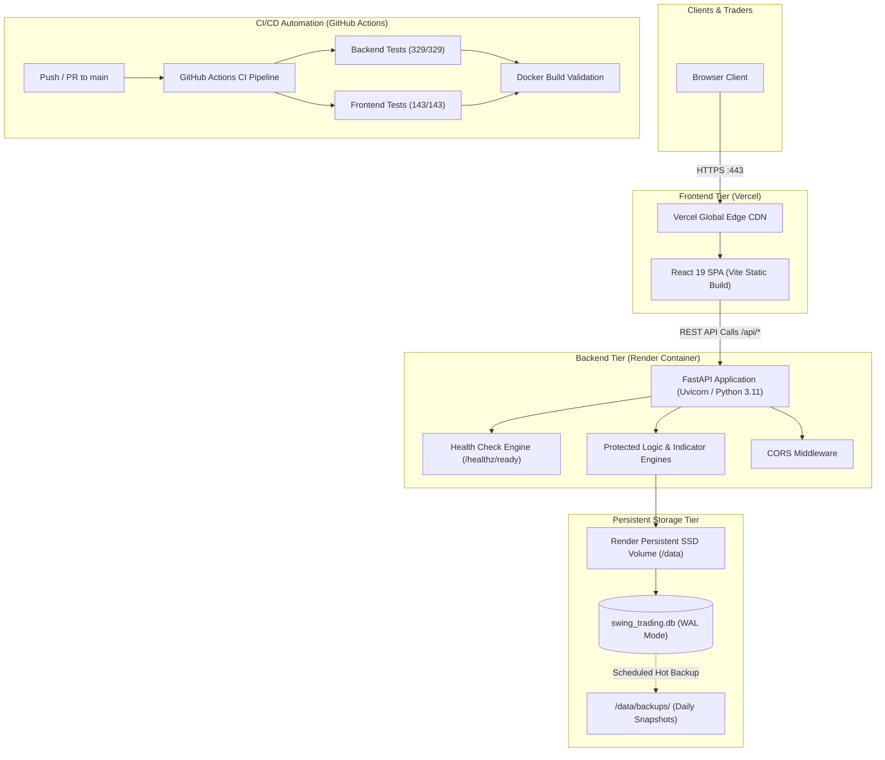

# Phase 3 — Cloud Deployment Architecture
**Swing Trading Intelligence Platform**
**Role:** Senior DevOps Engineer, Cloud Architect, Backend Engineer, Database Engineer
**Date:** November 6, 2026
**Status:** **APPROVED ARCHITECTURAL DESIGN SPECIFICATION**

---

## 1. Architectural Philosophy & Context

The Swing Trading Intelligence Platform is designed around the core operational philosophy:
> *"Finding the right stock in the right sector at the right time, with a clear explanation of why it qualifies."*

To support this philosophy reliably in the cloud, the architecture must satisfy four primary non-negotiable principles:
1. **Mathematical & Point-in-Time Integrity:** Financial disclosures, historical prices, and technical signals must never suffer from look-ahead bias, silent fallbacks, or data corruption.
2. **Decoupled Stateless Application Tier:** Frontend and backend containers must be decoupled, containerized, and stateless, allowing independent scaling, zero-downtime rolling deploys, and instant rollbacks.
3. **Guaranteed Persistent Storage:** Data must be durably stored in isolated persistent volumes with automated snapshot backups, isolated from ephemeral container lifecycles.
4. **Minimal Operational Overhead:** Pragmatic cloud hosting selections that optimize performance, stability, and cost while avoiding over-engineered distributed systems premature to current operational requirements.

---

## 2. Component Hosting Evaluations

### A. Frontend Hosting Evaluation: Vercel vs Self-Hosted Nginx Container

| Evaluation Metric | Vercel (Recommended Frontend Target) | Self-Hosted Nginx Container (Render/AWS ECS) |
| :--- | :--- | :--- |
| **Global Edge Delivery** | Global Anycast CDN with automatic asset compression (Brotli/Gzip) and edge caching. | Single-region container origin; requires configuring external Cloudflare CDN for edge caching. |
| **Deployment Previews** | Automatic per-pull-request preview URLs with isolated build environments. | Requires manual staging cluster configuration or dynamic container spinning. |
| **Build Pipeline** | Native Node.js build pipeline executing `npm run build` with environment injection (`VITE_API_BASE_URL`). | Multi-stage Docker container build executed on container host. |
| **SSL / Custom Domains** | Automatic zero-configuration Let's Encrypt certificates with HTTP/2 and HTTP/3 support. | Requires manual reverse-proxy SSL management or host ingress configuration. |
| **Cost** | Free tier covers personal and low-traffic production; Pro plan ($20/mo/seat) for teams. | Billed under container instance hours ($7/mo min per container). |
| **Operational Overhead**| Virtually zero infrastructure management; git-push to deploy. | Requires container monitoring, healthchecks, and Nginx ingress tuning. |

**Frontend Architectural Recommendation:**
**Vercel** is the recommended frontend deployment platform. The single-page application (React 19 + Vite 8 + Tailwind CSS v4) produces static assets (`dist/`) that benefit immensely from edge-caching and automated preview URLs on pull requests. The backend API base URL is injected at build time via `VITE_API_BASE_URL`.

---

### B. Backend Hosting Evaluation: Render vs AWS ECS / Google Cloud Run

| Evaluation Metric | Render Web Service (Recommended Target) | Google Cloud Run / AWS ECS Fargate |
| :--- | :--- | :--- |
| **Container Support** | Native Docker runtime building directly from repository `backend/Dockerfile`. | Native Docker container registry image deployment. |
| **Persistent Disk Attachment** | **Native Persistent Disks:** Attach persistent SSD disk directly to `/data` volume mount. | **Stateless Only:** Cloud Run does not support local persistent block storage without mounting network NFS (Cloud Storage FUSE / EFS), which adds latency and lock instability for SQLite. |
| **Health Check Probes** | Native health check path probe configured to `/healthz/ready`. | Native liveness and readiness probe configuration. |
| **Zero-Downtime Deploys** | Health-check gated rolling deployments with automatic rollback on probe failure. | Health-check gated blue/green deployments. |
| **SSL & Networking** | Automated HTTPS endpoints, internal private networking, custom domain SSL. | Automated HTTPS endpoints, Cloud Load Balancing. |
| **Cost** | Starter instance ($7/mo) + 1GB Persistent SSD disk ($0.25/mo) = ~$7.25/mo total. | $15–$35/mo minimum when factoring in continuous compute, VPC connector, and persistent storage. |
| **Operational Overhead**| Minimal: Deploy via Git commit or deploy hook without managing Kubernetes/Terraform. | Moderate-to-High: Requires IAM, Artifact Registry, VPC peering, and storage permissions. |

**Backend Architectural Recommendation:**
**Render Web Service (Docker)** is the recommended hosting platform for Phase 4. It supports persistent block disk mounts (`/data`), native container health check probing (`/healthz/ready`), non-root container users, and simple Git deploy-hook triggers, perfectly matching the Docker architecture validated in Phase 2.2.

---

### C. Database Architecture: SQLite with Persistent Disk vs PostgreSQL Migration

The Swing Trading Intelligence Platform currently uses SQLite for both production (`database/swing_trading.db`) and staging (`database/staging_financial_expansion.db`).

| Architectural Dimension | SQLite on Persistent Disk (Phase 3/4 Target) | PostgreSQL Managed Service (Future Scale Target) |
| :--- | :--- | :--- |
| **Read Performance** | Extremely fast in-process C-level access (sub-millisecond latency; zero network round-trip overhead). | Network socket latency (1–5ms per query); requires connection pooling (`pgbouncer`). |
| **Write Concurrency** | Single-writer serialization (WAL mode supports concurrent readers while one writer commits). | Multi-writer row-level locking (MVCC); high write concurrency. |
| **Current Query Profile** | **99% Read-Heavy / 1% Batch Writes:** Daily batch ingestion runs outside market hours; daytime traffic consists purely of read queries. | Over-provisioned for current read-heavy single-node daily swing trading use case. |
| **Operational Complexity** | Zero server administration; single portable file; zero connection leaks or socket exhaustion. | Requires database user management, VPC security groups, migration management, and vacuuming. |
| **Monthly Cost** | Included in Render persistent disk: ~$0.25 – $1.00/mo. | Managed Postgres: $7 – $35+/mo minimum (Render Postgres / Supabase / Neon). |
| **Backup Simplicity** | Direct hot atomic backups via `sqlite3.backup()` API (`backup_database.py`) to `/data/backups/`. | Logical dumps (`pg_dump`) or managed point-in-time recovery snapshots. |
| **Multi-Worker Scaling** | Limited to single container instance with multiple Uvicorn workers sharing disk lock. | Allows horizontal auto-scaling of backend API containers across multiple instances. |

**Database Architectural Strategy:**
1. **Phase 3 & 4 (Current Production Architecture):** Deploy SQLite on a persistent block storage volume mounted to `/data/swing_trading.db` on Render with WAL mode enabled (`PRAGMA journal_mode=WAL;`). This provides ultra-low latency, zero operational overhead, and negligible infrastructure cost.
2. **Migration Trigger (Future Multi-Instance Scaling):** When horizontal auto-scaling (multiple container instances) or real-time concurrent user writes are required, execute the PostgreSQL migration. All 22 data pipeline and query services already import `DATABASE_PATH` from `backend.config`, ensuring a clean architectural abstraction boundary for an eventual database adapter swap.

---

## 3. End-to-End System Architecture

---

## 4. Multi-Environment Staging & Production Strategy

To protect financial data integrity and ensure zero-downtime releases, four distinct environments are formally established:

| Environment | Host Infrastructure | Database State | Environment Purpose |
| :--- | :--- | :--- | :--- |
| **Local Development** | Local Windows/WSL2, Docker Desktop | Local `database/swing_trading.db` | Rapid feature development, UI prototyping, and unit test execution. |
| **Automated Testing (CI)** | GitHub Actions (`ubuntu-latest`) | In-memory / isolated mock databases | Automated PR regression testing, build verification, and linting. Never connects to production. |
| **Staging Environment** | Render Staging Web Service + Vercel Preview | Isolated staging disk replica (`staging_financial_expansion.db`) | Pre-release acceptance testing, smoke tests, and data pipeline verification before live rollout. |
| **Production Environment**| Render Production Web Service + Vercel Production | Protected persistent disk (`/data/swing_trading.db`) | Live user-facing platform serving verified trading opportunities and technical ratings. |

---

## 5. Security, Secrets & Environment Variable Architecture

### Security Principles:
- **Zero Secrets in Git:** All `.env`, `.env.local`, and SQLite `.db` files are strictly excluded via `.gitignore` and `.dockerignore`.
- **Least-Privilege Execution:** Backend containers run as unprivileged `appuser` (UID `10001`).
- **Sanitized Error Responses:** Backend 503 and 500 error responses mask internal filesystem paths to prevent directory disclosure.

### Environment Variable Matrix:

| Variable Name | Environment Scope | Local Default | Production Value (Render / Vercel) | Description |
| :--- | :--- | :--- | :--- | :--- |
| `DATABASE_PATH` | Backend | `database/swing_trading.db` | `/data/swing_trading.db` | Path to persistent SQLite database file |
| `PORT` | Backend | `8000` | `8000` | Port for ASGI server |
| `HOST` | Backend | `0.0.0.0` | `0.0.0.0` | Bind host interface |
| `CORS_ORIGINS` | Backend | `http://localhost,http://localhost:5173` | `https://swing-trading.vercel.app` | Allowed cross-origin domains |
| `PYTHONUTF8` | Backend | `1` | `1` | Forces UTF-8 encoding for standard I/O |
| `VITE_API_BASE_URL` | Frontend | `http://localhost:8000` | `https://swing-trading-api.onrender.com` | Backend REST API upstream URL |
| `VITE_USE_MOCK_DATA`| Frontend | `false` | `false` | Must remain false in staging and production |

### GitHub Actions Secrets (Reserved for Phase 4 Deployment Automation):
- `RENDER_API_KEY`: API token used to trigger deploy hooks on Render.
- `RENDER_SERVICE_ID`: Identifier of the Render backend web service.
- `VERCEL_TOKEN`: Vercel automation token for CLI deployments.
- `VERCEL_ORG_ID`: Vercel Organization ID.
- `VERCEL_PROJECT_ID`: Vercel Project ID.

---

## 6. Monitoring, Observability & Health Checking

### 1. Health Probe Hierarchy:
- **Liveness Probe (`/healthz/live`):** Returns HTTP `200 OK` if the Python Uvicorn process is responding to HTTP requests. Render checks this to detect deadlocks.
- **Readiness Probe (`/healthz/ready`):** Returns HTTP `200 OK` only when:
  1. The SQLite file exists at `DATABASE_PATH`.
  2. Database connectivity is verified (`SELECT 1`).
  3. Essential schema tables exist (`stock_metadata`, `stock_daily_technicals`, `stocks`).
  4. Active stock count is greater than zero (`SELECT COUNT(*) FROM stocks WHERE active = 1`).
  If any check fails, returns HTTP `503 Service Unavailable`, preventing traffic routing to unseeded or corrupted instances.

### 2. Log Ingestion & Error Tracking:
- **Application Logs:** Structured JSON / standard logging emitted to `stdout` / `stderr`.
- **Render Dashboard:** Aggregates container stdout logs with real-time tailing, search, and memory/CPU metrics.
- **Alerting:** Configured email/webhook notifications triggered on container restart or health check failure.
