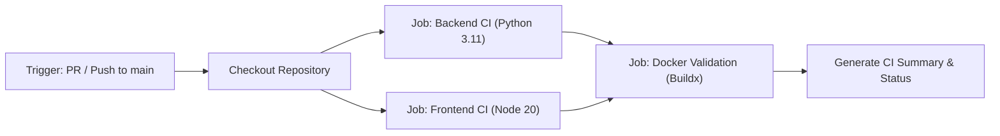

# Phase 3 — GitHub Actions CI/CD Guide
**Swing Trading Intelligence Platform**
**Role:** Senior DevOps Engineer, Infrastructure Reliability Specialist
**Date:** November 6, 2026
**Status:** **OPERATIONAL REFERENCE MANUAL**

---

## 1. Overview of the CI Pipeline

The continuous integration (CI) pipeline for the Swing Trading Intelligence Platform is defined in:
[`.github/workflows/ci.yml`](file:///c:/Users/vigne/OneDrive/Desktop/projects/swing-trading-tool/.github/workflows/ci.yml)

The pipeline executes automatically on every pull request targeting `main`, every direct push to `main`, and can also be triggered manually via GitHub's `workflow_dispatch`.



---

## 2. Job Architecture & Execution Details

### A. Backend CI Job (`backend-ci`)
- **Target OS:** `ubuntu-latest`
- **Python Version:** `3.11` (matches container runtime `python:3.11-slim`)
- **Execution Timeout:** 15 minutes
- **Caching:** Caches pip download cache keyed by `backend/requirements.txt`.
- **Steps:**
  1. `actions/checkout@v4`: Clones repository.
  2. `actions/setup-python@v5`: Configures Python 3.11 and pip caching.
  3. `Install dependencies`: Upgrades pip, installs `backend/requirements.txt` and `backend/requirements-dev.txt`.
  4. `Run backend test suite`: Executes `python -m pytest backend/tests/ -v --tb=short` with `PYTHONUTF8=1` and `DATABASE_PATH=database/swing_trading.db`.
  5. `Generate test summary`: Writes execution metrics to `$GITHUB_STEP_SUMMARY`.

### B. Frontend CI Job (`frontend-ci`)
- **Target OS:** `ubuntu-latest`
- **Node.js Version:** `20` (matches container build stage `node:20-alpine`)
- **Execution Timeout:** 10 minutes
- **Caching:** Caches npm package cache keyed by `frontend/package-lock.json`.
- **Steps:**
  1. `actions/checkout@v4`: Clones repository.
  2. `actions/setup-node@v4`: Configures Node.js 20 and npm caching.
  3. `Install dependencies`: Runs `npm --prefix frontend ci` for deterministic package installation from lockfile.
  4. `Run frontend unit tests`: Runs `npm --prefix frontend test` (executing all 143 Vitest tests).
  5. `Run frontend production build`: Runs `npm --prefix frontend run build` to verify Vite bundle compilation without warnings/errors.
  6. `Generate frontend summary`: Writes compilation results to `$GITHUB_STEP_SUMMARY`.

### C. Docker Validation Job (`docker-validation`)
- **Target OS:** `ubuntu-latest`
- **Dependencies:** Runs only after `backend-ci` and `frontend-ci` pass (`needs: [backend-ci, frontend-ci]`).
- **Execution Timeout:** 15 minutes
- **Security Rule:** Images are compiled locally for validation only. `push: false` ensures zero image artifacts are published to public or external registries.
- **Steps:**
  1. `actions/checkout@v4`: Clones repository.
  2. `docker/setup-buildx-action@v3`: Configures Docker Buildx builder.
  3. `Validate Backend Docker Image Build`: Builds `backend/Dockerfile` with context `.`.
  4. `Validate Frontend Docker Image Build`: Builds `frontend/Dockerfile` with context `./frontend` and build-arg `VITE_API_BASE_URL=http://localhost:8000`.

---

## 3. Recommended GitHub Branch Protection Settings

To ensure no unverified code or broken tests ever enter the `main` branch, configure the following branch protection rules in GitHub (**Settings** -> **Branches** -> **Branch protection rules** for `main`):

1. **Require a pull request before merging:**
   - Enable: *"Require approvals"* (minimum 1 peer review approval).
   - Enable: *"Dismiss stale pull request approvals when new commits are pushed"*.
2. **Require status checks to pass before merging:**
   - Enable: *"Require branches to be up to date before merging"*.
   - Required Status Checks:
     - `Backend Tests & Governance Audit`
     - `Frontend Tests & Production Build`
     - `Docker Image Build Validation`
3. **Require conversation resolution before merging:**
   - All code review comments and audit questions must be marked resolved.
4. **Do not allow bypassing the above settings:**
   - Enforce for administrators as well as developers.
5. **Restrict direct pushes:**
   - Prevent any direct `git push origin main`. All changes must arrive via verified pull requests.

---

## 4. Local Developer Pre-Push Checklist

Before submitting a Pull Request, developers must run the following local commands to ensure 100% first-time CI pass rates:

### Step 1: Run Backend Tests
```powershell
python -m pytest backend/tests/ -v --tb=short
```
*Expected: 329 passed.*

### Step 2: Run Frontend Tests & Build
```powershell
npm --prefix frontend test
npm --prefix frontend run build
```
*Expected: 143 passed, Vite build completes with 0 errors.*

### Step 3: Verify Docker Image Builds
```powershell
docker build -t swing_trading_backend:local -f backend/Dockerfile .
docker build -t swing_trading_frontend:local -f frontend/Dockerfile ./frontend
```
*Expected: Both images build cleanly with 0 errors.*

### Step 4: Verify Database Invariant
```powershell
(Get-FileHash -Algorithm SHA256 database/swing_trading.db).Hash
```
*Expected: `1A2036FCC72AF59B3633B5C2A077C26DD45756B3360824F36E995E2E805A28A8`.*

---

## 5. Troubleshooting CI Failures

| Failure Symptom | Likely Cause | Investigation & Remedy |
| :--- | :--- | :--- |
| `NameError: name 'X' is not defined` in `backend-ci` | Missing typing import evaluated under Python 3.11 | Check if a typing annotation (`Any`, `Optional`, `List`) was used without being imported from `typing`. Python 3.11 evaluates annotations at import time. |
| `503 Service Unavailable` on database test | Missing or unseeded database path | Ensure `DATABASE_PATH=database/swing_trading.db` environment variable is defined in the test step. |
| `npm ci` fails with lockfile error in `frontend-ci` | `package.json` and `package-lock.json` out of sync | Run `npm --prefix frontend install` locally and commit the synchronized `frontend/package-lock.json`. |
| Vite build error: `Failed to resolve import` | Case sensitivity or missing file extension | Linux GitHub runners use case-sensitive filesystems. Ensure import casing exactly matches the file path on disk (e.g. `Sidebar.jsx`, not `sidebar.jsx`). |
| Docker build fails: `COPY failed` | File blocked by `.dockerignore` | Inspect `.dockerignore` to confirm required build assets are not inadvertently filtered. |
