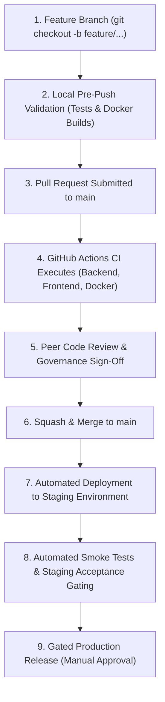

# Phase 3 — Release & Rollback Strategy Guide
**Swing Trading Intelligence Platform**  
**Role:** Senior DevOps Engineer, Release Manager, Infrastructure Reliability Specialist  
**Date:** November 6, 2026  
**Status:** **OPERATIONAL GOVERNANCE MANUAL**

---

## 1. Release Lifecycle & Promotion Workflow

The release process follows a strict 9-step progression designed to guarantee zero disruption to live trading intelligence and zero corruption of historical financial data:



### Detailed Release Stages:
1. **Feature Development:** Developers work on isolated feature branches (`feature/<name>` or `fix/<name>`). Direct commits to `main` are strictly blocked.
2. **Local Pre-Flight:** Developer executes local test suites (329 backend, 143 frontend, Docker image builds).
3. **Pull Request Creation:** Pull request opened against `main` with detailed explanation of changes.
4. **CI Pipeline Validation:** GitHub Actions runs `backend-ci`, `frontend-ci`, and `docker-validation`. All jobs must pass green.
5. **Peer Review:** Minimum of 1 authorized engineer reviews and approves the pull request.
6. **Merge to Main:** Pull request is squashed and merged into `main`.
7. **Staging Rollout:** Merging to `main` automatically triggers deployment to the Staging Web Service on Render and Vercel Staging Preview.
8. **Staging Smoke Tests:** Automated health check probes verify `/healthz/ready`, `/api/stocks`, `/api/sectors`, and frontend rendering against `staging_financial_expansion.db`.
9. **Production Promotion:** Production release requires manual approval by an authorized release manager. The live container image is promoted to the production Render Web Service.

---

## 2. Detecting Release Degradation & Fault Conditions

A production release must be immediately flagged for investigation or rollback if any of the following telemetry indicators trigger:

| Anomaly Indicator | Detection Threshold | Recommended Action |
| :--- | :--- | :--- |
| **Health Check Failure** | `/healthz/ready` returns HTTP `503` for > 30 seconds | Render automatically halts deployment; initiate immediate rollback. |
| **HTTP Error Surge** | 5xx error rate exceeds `1.0%` over a 5-minute window | Roll back application image immediately. |
| **Frontend Exception Rate**| Uncaught JavaScript error rate spikes in browser console | Revert Vercel deployment to previous production alias. |
| **Opportunity Score Anomaly**| Total qualified opportunities drops to 0 across the entire universe or exceeds 90% | Halt trade signals; inspect data pipeline and indicator models. |
| **Database Lock Contention**| SQLite `OperationalError: database is locked` frequency spikes | Restart container; verify WAL mode checkpointing. |

---

## 3. Fast Rollback Procedures

### A. Application Rollback (Stateless Tier)
Because container images and frontend static bundles are strictly stateless, application rollbacks can be executed in under 60 seconds with zero data loss.

#### 1. Backend Application Rollback on Render:
1. Navigate to the **Render Dashboard** -> Select `swing-trading-backend` service.
2. Click on the **Deploys** tab.
3. Locate the previous stable deployment (the last deployment known to be healthy).
4. Click the three dots (`...`) next to that deployment and select **Rollback to this deploy**.
5. Render immediately stops routing traffic to the failed container and activates the previous verified Docker image.

#### 2. Frontend Application Rollback on Vercel:
1. Navigate to the **Vercel Dashboard** -> Select `swing-trading-frontend` project.
2. Click on the **Deployments** tab.
3. Locate the previous production deployment.
4. Click the three dots (`...`) and select **Instant Rollback**.
5. Vercel re-points the production edge CDN alias to the prior static build within seconds.

---

### B. Database Rollback & Recovery Strategy

Because the application uses persistent storage for SQLite (`/data/swing_trading.db`), database recovery requires distinct protocols to prevent accidental data loss.

#### 1. Backward-Compatible Migrations Rule
- **Non-Destructive Schema Evolution:** Any database schema change must be additive (e.g. adding columns with `NULL` defaults, creating new tables or indexes).
- **Never drop columns or tables in an initial release.** This guarantees that if the application tier is rolled back to a previous container version, the older application code will continue to execute queries without syntax errors.

#### 2. Restoring from Automated Snapshot Backups:
If an erroneous data ingestion corrupts the production database, restore from the latest clean hot backup generated by [backend/data_pipeline/backup_database.py](file:///c:/Users/vigne/OneDrive/Desktop/projects/swing-trading-tool/backend/data_pipeline/backup_database.py):

1. **SSH / Shell into Render Backend Container:**
   ```bash
   # List available persistent backups
   ls -la /data/backups/
   ```
2. **Execute Database Restoration Script:**
   ```bash
   python -m backend.data_pipeline.restore_database --backup /data/backups/swing_trading_YYYYMMDD_HHMMSS.db
   ```
   *The restoration script automatically safely archives the existing corrupted file to `/data/recovery/` before atomically swapping the clean backup into `/data/swing_trading.db`.*
3. **Verify Database Readiness Probe:**
   ```bash
   curl -s http://localhost:8000/healthz/ready
   ```
   *Confirm output returns `{"status":"ready","companies_count":52}`.*

---

## 4. Emergency Maintenance Mode Protocol

In the event of an unprecedented market data anomaly or catastrophic exchange feed error:
1. Set environment variable `MAINTENANCE_MODE=true` on the Render backend web service.
2. The FastAPI middleware intercepts incoming requests and returns HTTP `503 Service Unavailable` with `{"status":"maintenance","message":"System undergoing scheduled maintenance"}`.
3. The frontend displays a clean "System Maintenance" banner, preserving user trust while preventing erroneous trade executions.
4. Once the data issue is remediated and verified, unset `MAINTENANCE_MODE` and trigger container restart.

