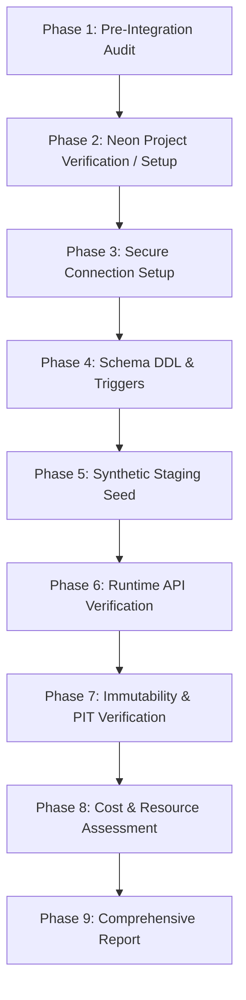

# PHASE 5.3.7 — NEON POSTGRESQL STAGING INTEGRATION PLAN

**Date:** 2026-11-07
**Status:** DRAFT / IN-PROGRESS
**Target Environment:** Neon Free Tier Serverless PostgreSQL 16 (`swing-trading-staging`)
**Deployment Cost:** ₹0 / month

---

## 1. Pre-Integration Architectural Audit

### 1.1. Core Components Inspected

| Component | Path | Inspection Findings | Compliance Status |
| :--- | :--- | :--- | :---: |
| **Database Access Layer (DAL)** | `backend/database/connection.py` | Environment-driven `DATABASE_URL` parser, credentials masking (`mask_database_url`), thread-safe `psycopg_pool.ConnectionPool`, and fail-closed security preventing silent fallback to SQLite. | ✅ COMPLIANT |
| **PostgreSQL 16 Schema** | `backend/database/schema_pg.sql` | 15 domain tables with native types (`BIGSERIAL`, `BOOLEAN`, `TIMESTAMPTZ`, `DOUBLE PRECISION`), generated columns (`STORED`), and 3 financial immutability PL/pgSQL triggers. | ✅ COMPLIANT |
| **Staging Seed Utility** | `backend/database/staging_seed.py` | Contains 10 synthetic Indian equities, price bars, and verified PIT quarterly financial vintages. Uses raw SQLite; needs a DAL-native synthetic seeder for Neon. | ⚠️ ADAPTATION NEEDED |
| **Configuration Module** | `backend/config.py` | Configures `DATABASE_PATH` with `_DatabasePath` dynamic proxy, `HOST`, `PORT`, `CORS_ORIGINS`. Defers to DAL for database engine selection. | ✅ COMPLIANT |
| **Dependency Declarations** | `backend/requirements.txt` | Includes `psycopg[binary]>=3.2.0,<4.0.0` and `psycopg-pool>=3.2.0,<4.0.0`. | ✅ COMPLIANT |
| **Source Protection & Git** | `.gitignore`, `git status` | `.env*` files are strictly gitignored (except `.env.example`). No credentials committed. | ✅ COMPLIANT |
| **Regression Baseline** | `PHASE_5_3_6_1_FINAL_REGRESSION_REPORT.md` | All 375 backend tests, 43 PG runtime tests, and 143 frontend tests verified. Zero modifications to `backend/logic/`. | ✅ COMPLIANT |

---

## 2. Invariant & Safety Governance Verification

1. **Environment-Driven Configuration:**
   - When `DATABASE_URL` is set, `parse_database_url` selects `DatabaseEngine.POSTGRESQL`.
   - When `DATABASE_URL` is unset, `parse_database_url` selects `DatabaseEngine.SQLITE` targeting `database/swing_trading.db`.
2. **Fail-Closed Security Invariant:**
   - If `DATABASE_URL` is configured with a PostgreSQL URL, any network, authentication, or query failure immediately raises `DatabaseConnectionError` or `DatabaseQueryError`.
   - Under no circumstances does the application silently degrade or fall back to local SQLite.
3. **Credential & Secret Protection:**
   - All connection logging passes through `mask_database_url()` to redact passwords (`user:***@host`).
   - `DATABASE_URL` will never be printed in logs, frontend bundles, or error responses.
   - Credentials will be loaded from a private, untracked `.env` file or local execution environment.
4. **Source Database Protection:**
   - `database/swing_trading.db` (`SHA-256: 1A2036FCC72AF59B3633B5C2A077C26DD45756B3360824F36E995E2E805A28A8`) and `database/staging_financial_expansion.db` (`SHA-256: 84263F185EC782443F8C15F08F0AEAB96C0BD8B40413D5ADD12C3AE908176BE7`) must NEVER be uploaded, migrated, or connected to Neon.
   - Only synthetic test data will be seeded into Neon.
5. **Protected Logic Invariant:**
   - `backend/logic/signal_engine.py`, `backend/logic/trade_quality_engine.py`, and `backend/logic/portfolio_simulator.py` must remain completely untouched.

---

## 3. Neon Free Plan Architecture & Limits

Neon's Free Tier provides serverless PostgreSQL with scale-to-zero capabilities:

| Dimension | Neon Free Tier Limit | Swing Trading Staging Requirement | Zero-Cost Headroom |
| :--- | :--- | :--- | :--- |
| **Project Count** | 1 project | 1 project (`swing-trading-staging`) | 100% within free tier |
| **Branches** | Up to 10 branches | 1 branch (`staging` or `main`) | 9 spare branches |
| **Database Storage** | 0.5 GiB (512 MB) per branch | Synthetic staging data: < 5 MB | > 99% headroom |
| **Compute Scaling** | 0.25 vCPU (burstable to 1.0) | API request workload: 0.25 vCPU | 100% within free tier |
| **Autosuspend** | Inactivity timeout: 5 minutes | Allowed to autosuspend when idle | 0 compute wasted |
| **Compute Usage** | 100 Compute Unit (CU) hours / month | Staging API testing: ~2-5 CU-hrs/mo | ~95% monthly headroom |
| **Cost** | ₹0 / month ($0.00) | Target: ₹0 / month ($0.00) | **₹0 / month** |

### Connection Pooling Strategy for Neon
- Neon endpoints support direct connections (`ep-xxx.region.aws.neon.tech`) and pooled connections (`ep-xxx-pooler.region.aws.neon.tech` via built-in PgBouncer).
- Our backend DAL uses `psycopg_pool.ConnectionPool` with client-side connection pooling.
- Recommended configuration for Neon:
  - `min_size=0` or `1`: Allows the connection pool to scale down when idle, enabling Neon compute to autosuspend cleanly.
  - `max_size=5`: Conservative pool cap well within Neon's connection limits.
  - `sslmode=require`: Mandatory for all Neon PostgreSQL connections.

---

## 4. Phase-by-Phase Integration Strategy

### Next Steps:
1. Complete Pre-Integration Audit documentation.
2. Verify with Project Owner regarding Neon credentials/connection details for `swing-trading-staging` (without pasting plaintext secrets into chat).
3. Initialize schema and apply immutability triggers on Neon.
4. Execute synthetic seeding and runtime integration verification.
