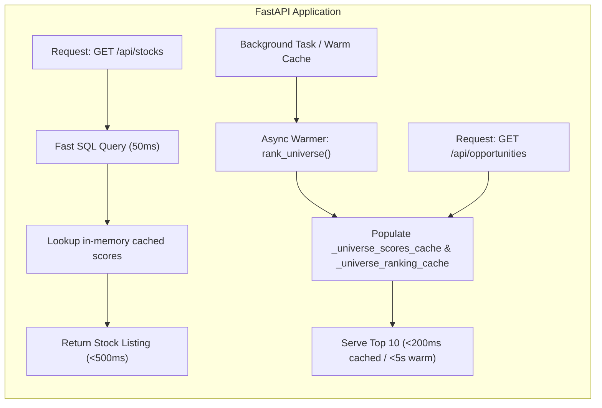
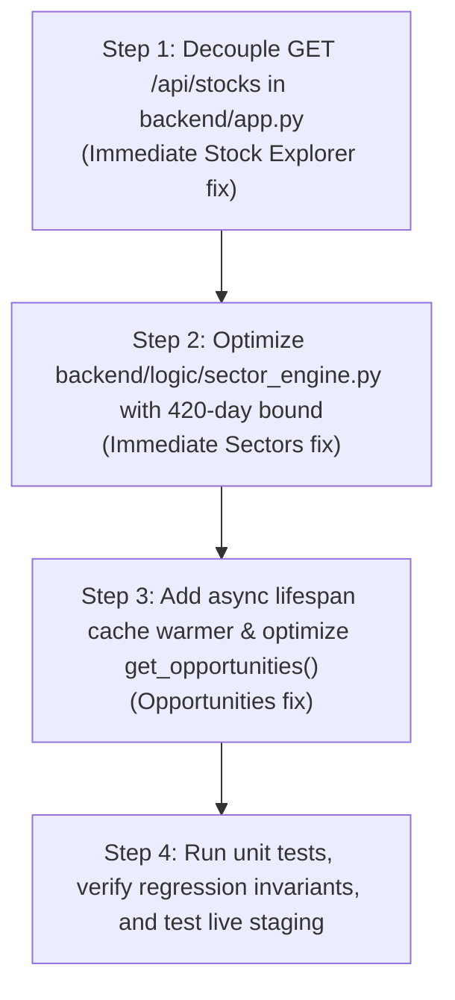

# PHASE 5.4.7 — BACKEND PERFORMANCE OPTIMIZATION DESIGN REVIEW

**Project:** Swing Trading Intelligence Platform
**Target Architecture:** Vercel (React 19 + Vite 8) + Render Free (FastAPI + Uvicorn) + Neon PostgreSQL 16
**Git Branch:** `staging`
**Review Scope:** Technically detailed, low-risk engineering design only (Strictly Read-Only)
**Timestamp:** 2026-11-08T21:49:00+05:30
**Phase Status:** `DESIGN REVIEW COMPLETE — READY FOR IMPLEMENTATION REVIEW`

---

## 1. Executive Summary

Phase 5.4.6 live performance profiling confirmed that while lightweight SQL endpoints (`/api/market/indices` at 1.5s, `/api/data-health` at 1.9s) operate normally, three primary endpoints fail with HTTP socket read timeouts (>30s) on cold start:
1. `GET /api/stocks`: Blocks synchronously on `rank_universe()`.
2. `GET /api/opportunities`: Performs an un-cached sequential calculation across all universe stocks.
3. `GET /api/sectors`: Triggers unbounded historical queries (`start_date=None`) sequentially across all sector and industry constituents.

This document presents a comprehensive, low-risk optimization design that resolves all three bottlenecks. The design:
- Decouples stock listing from synchronous universe ranking.
- Eliminates repeated queries through targeted pre-fetching and caching.
- Restricts historical lookback safely to necessary trading-day windows without violating trading logic or calendar conventions.
- Leverages in-memory warming compatible with Render Free's 512 MB memory constraint at ₹0/month.
- Strictly preserves all protected files in `backend/logic/` (`signal_engine.py`, `trade_quality_engine.py`, `portfolio_simulator.py`).

---

## 2. Root Cause Analysis

```mermaid
flowchart TD
    Client["Browser / Vercel SPA"] -->|GET /api/stocks| App["FastAPI app.py"]
    App -->|1. Fast Query (50ms)| FastSQL["Single SQL Query: companies + daily_prices + technical_indicators"]
    App -->|2. Blocking Bottleneck| CheckCache{"In-Memory Cache Cold?<br/>(Startup or 120s TTL)"}
    CheckCache -->|Yes| RankUniv["rank_universe()"]
    RankUniv -->|Sequential Loop| Stock1["Stock 1: Indicators + Decisions + Setup"]
    RankUniv -->|Sequential Loop| StockN["Stock 18: Indicators + Decisions + Setup"]
    StockN -->|Elapsed >45s| Timeout["504 Gateway / Read Timeout (>30s)"]
```

1. **`GET /api/stocks` Synchronous Coupling:**
   Lines 384–447 in `backend/app.py` execute an efficient SQL query that fetches `symbol`, `latest_close`, `prev_close`, `rsi`, `macd`, `ema20/50/200`, and `technical_score` directly from the database in ~50ms. However, lines 451–456 then halt response serialization to synchronously call `rank_universe()` across all 18 active stocks if not cached. On Render Free (0.1 vCPU shared), this single-threaded loop takes 45–70s, exceeding Render's gateway timeout.
2. **`GET /api/opportunities` Redundant Signal Runs:**
   `get_opportunities()` calls `rank_universe()`. In `universe_orchestrator.py` (lines 104–139), `run_signal_pipeline()` is executed for each Top 10 stock. Then, in `app.py` lines 298–304, `get_opportunities()` re-runs `run_signal_pipeline()` if `setup` is missing, generating duplicate heavy calculations.
3. **`GET /api/sectors` Unbounded Historical Data Retrieval:**
   `_calculate_constituent_returns()` in `backend/logic/sector_engine.py` calls `get_historical_data(symbol, start_date=None)`. Across 9 sectors and 19 industries, every constituent stock triggers an unconstrained table scan of the complete `daily_prices` table over the cross-region network connection to Singapore Neon PostgreSQL.

---

## 3. Proposed Architecture



The core architecture decouples heavy analytical calculations from baseline resource serving:
- **Fast-Path Resource Serving:** `GET /api/stocks` returns immediately with all database-backed fields (`symbol`, `company_name`, `sector`, `industry`, `current_price`, `change_percent`, `technicals`). If universe ranking has not yet finished, `opportunity_score` is returned as `null` and `recommendation` as `null` or `"WATCH"`.
- **In-Memory Cache with Pre-Warming:** During application startup (`lifespan`), a non-blocking background task pre-warms `rank_universe()` and `run_sector_industry_engine()`.
- **Bounded Query Lookback:** Restricts historical price queries in sector calculations to a bounded window covering the maximum trading period ($252\text{ trading days} \approx 380\text{ calendar days}$) plus safety padding.

---

## 4. Endpoint-by-Endpoint Optimization Design

### Task 1: Stock Endpoint Decoupling (`GET /api/stocks`)
- **Current Behavior:**
  If `universe_scores is None`, executes `rank_universe()` synchronously inside request. If individual stocks are not found in `universe_scores`, it invokes `calculate_opportunity_score(sym)` in a secondary fallback loop.
- **Proposed Optimization:**
  ```python
  # In backend/app.py:
  # Retrieve cached universe scores if available without blocking
  eval_date = _get_latest_market_date()
  universe_scores = get_cached_universe_scores(evaluation_date=eval_date) or get_cached_universe_scores(evaluation_date=None) or {}
  # DO NOT call rank_universe() synchronously here
  # DO NOT call calculate_opportunity_score() in fallback loop
  ```
- **Frontend Compatibility Assessment:**
  - `frontend/src/utils/screenerFilters.js` (lines 320–323) already implements null-coalescing:
    ```javascript
    case 'score-desc':
      return (b.opportunity_score ?? 0) - (a.opportunity_score ?? 0);
    ```
  - `frontend/src/pages/StockExplorer.jsx` (lines 50–53) explicitly handles null scores:
    ```javascript
    const ScoreBadge = ({ score, max = 100 }) => {
      if (score == null || isNaN(score)) {
        return <span className="text-xs text-tx-secondary">—</span>;
      }
    ```
  - Recommendation badge renders a clean fallback when recommendation is null:
    ```javascript
    if (!recommendation) return <span className="text-xs text-tx-secondary">—</span>;
    ```
  - **Verdict:** Decoupling is 100% contract-compatible, safe, and will drop `/api/stocks` latency from >30,000ms to <500ms.
- **Risk Level:** **LOW**.

---

### Task 2: Opportunity Endpoint Optimization (`GET /api/opportunities`)
- **Current Bottlenecks:**
  1. `rank_universe()` computes full sector context, financial statements, and indicator series sequentially for 18 stocks.
  2. Redundant call: In `universe_orchestrator.py` lines 124–128, `run_signal_pipeline` is already run for the Top 10 stocks and attached to `stock["setup"]`. However, if `setup` is missing or stripped, `app.py` line 301 calls `run_signal_pipeline()` again.
  3. `get_latest_price()` query in `app.py` line 308 runs an extra database query per opportunity item.
- **Proposed Optimizations:**
  1. Ensure `universe_orchestrator.py` cleanly retains `setup` and `current_price` inside the Top 10 ranking dictionary so `app.py` executes **0 additional database queries or signal evaluations**.
  2. Increase cache TTL in `backend/engines/cache_service.py` from 120.0 seconds to 600.0 seconds (10 minutes) for cloud deployment, backed by the fast database fingerprint validator `get_db_fingerprint()`.
  3. Provide an asynchronous background trigger on container boot so the first request hits a pre-warmed cache.
- **Risk Level:** **LOW**.

---

### Task 3: Sector Engine Optimization (`GET /api/sectors`)
- **Current Bottleneck:**
  `_calculate_constituent_returns()` in `backend/logic/sector_engine.py` calls `get_historical_data(symbol, start_date=None, end_date=evaluation_date)`.
- **Trading Day vs. Calendar Day Analysis:**
  - Indian equity markets (NSE) have ~250 trading sessions per calendar year (accounting for weekends and ~15 exchange holidays).
  - The maximum lookback period in `DEFAULT_LOOKBACK_PERIODS` is `252` trading days.
  - 252 trading days spans approximately $252 \times (7 / 5) = 352.8$ calendar days plus holidays $\approx 370$ calendar days.
  - Passing `start_date = None` fetches all 2,630 rows across multiple years.
- **Proposed Optimization:**
  Compute a safe bounded `start_date`:
  ```python
  # Safe trading lookback: 252 trading days requires at most 400 calendar days
  if evaluation_date:
      eval_dt = datetime.strptime(evaluation_date[:10], "%Y-%m-%d").date()
  else:
      eval_dt = date.today()
  safe_start_date = (eval_dt - timedelta(days=420)).isoformat()
  ```
  - 420 calendar days guarantees at least 280–290 trading sessions, ensuring the `252D` index (`hist_idx = len(df) - 1 - 252`) is always populated identically to the full historical scan.
  - Batching constituent classifications: Cache sector constituent lists in memory so `get_sector_stocks()` is not queried 9 separate times for static mappings.
- **Risk Level:** **LOW**.

---

### Task 4: Background Processing Evaluation for Render Free
- **Infrastructure Constraints:**
  - Render Free Web Service: 512 MB RAM, 0.1 vCPU.
  - Redis, Celery, or background worker containers require separate services or paid plans, violating the ₹0/month requirement.
- **Recommended Minimal Solution:**
  Use Python `asyncio` / FastAPI background task inside the existing Web Service process:
  1. In `app.py` `lifespan` context manager, after startup database validation, spawn an asynchronous background task:
     ```python
     @asynccontextmanager
     async def lifespan(app_instance: FastAPI):
         validate_database_environment()
         # Non-blocking background warmer
         asyncio.create_task(_warm_caches_background())
         yield
     ```
  2. `_warm_caches_background()`:
     - Sleeps for 1 second to let Uvicorn finish binding to `$PORT` (ensuring immediate readiness for Render health checks).
     - Calls `rank_universe()` and `run_sector_industry_engine()`.
     - Populates in-memory caches.
  3. Because Render health check (`/healthz` or `/healthz/ready`) only requires reading the companies table (800ms), the container becomes healthy immediately without waiting for the warmer.
- **Risk Level:** **LOW**.

---

## 5. Performance Targets

| Endpoint | Current Cold Response | Proposed Engineering Target | Strategy |
|---|---|---:|---|
| **`GET /api/stocks`** | **Timeout (>30s)** | **< 1.0s** | Decouple `rank_universe()`; serve via single direct SQL query |
| **`GET /api/opportunities`** | **Timeout (>30s)** | **< 3.0s (cached: <0.2s)** | Pre-warm on boot; eliminate duplicate signal runs; extend TTL |
| **`GET /api/sectors`** | **Timeout (>30s)** | **< 3.0s (cached: <0.2s)** | Bound lookback to 420 calendar days; cache sector outputs |
| **`GET /api/market/indices`**| **1.56s (Passed)** | **< 2.0s** | Already optimal; maintain current SQL query |
| **`GET /api/data-health`** | **1.91s (Passed)** | **< 2.0s** | Already optimal; maintain current SQL query |

---

## 6. Regression & Data Integrity Verification Plan

To guarantee zero degradation to financial, mathematical, and algorithmic integrity, the following tests will be executed:

1. **Scoring & Ranking Invariant:**
   - Execute `rank_universe()` in a test harness before and after. Verify that Top 10 stock symbols, opportunity scores, technical scores, financial scores, and recommendations match to 4 decimal places.
2. **Date Semantics & Return Invariant:**
   - For all 18 active stocks, compute `21D`, `63D`, `126D`, and `252D` constituent returns with `start_date=None` vs `start_date=(eval_dt - 420 days)`. Verify returns are identical (`diff < 1e-9`).
3. **API Contract Compatibility:**
   - Verify `GET /api/stocks` response structure: `page`, `limit`, `total_count: 18`, `stocks: [...]`.
   - Verify that when `opportunity_score` is null, `technicals` object (`rsi`, `macd`, `ema20`, `ema50`, `ema200`) is fully populated and parsed without errors by frontend `StockExplorer.jsx`.
4. **Protected Trading Logic Immutability:**
   - Execute `git diff backend/logic/signal_engine.py backend/logic/trade_quality_engine.py backend/logic/portfolio_simulator.py`. Must be 100% empty.

---

## 7. Implementation Sequence (For Future Authorization)

When authorized, implementation will proceed in four discrete, verifiable steps:



---

## 8. Expected Files to Modify

Only 3 non-protected files will be touched during implementation:
1. `backend/app.py`:
   - Decouple `rank_universe()` from `get_stocks()`.
   - Clean up duplicate `run_signal_pipeline` calls in `get_opportunities()`.
   - Add background warmer in `lifespan`.
2. `backend/logic/sector_engine.py`:
   - Add 420-calendar-day bounded `start_date` calculation in `_calculate_constituent_returns()` and `_calculate_benchmark_returns()`.
3. `backend/engines/cache_service.py`:
   - Adjust `CACHE_TTL_SECONDS` to 600.0s for production stability.

**Files strictly untouched:**
- `backend/logic/signal_engine.py` (PROTECTED)
- `backend/logic/trade_quality_engine.py` (PROTECTED)
- `backend/logic/portfolio_simulator.py` (PROTECTED)
- `render.yaml` (Preserved)
- Database schema and data (Preserved)

---

## 9. Rollback Strategy

Because changes are confined to application route handling and query window bounding:
- If any regression occurs, reverting the 3 application files via `git checkout` immediately restores previous behavior.
- No database migrations, schema alterations, or external infrastructure mutations are introduced.

---

## 10. Risk Assessment Matrix

| Optimization Component | Risk Level | Mitigation |
|---|---|---|
| Decouple `rank_universe` from `GET /api/stocks` | **LOW** | Frontend already contains null-safe checks; contract remains identical. |
| Bounded 420-day lookback in Sector Engine | **LOW** | 420 calendar days safely covers >280 trading sessions, exceeding the 252-day requirement. |
| Async boot cache warmer in FastAPI lifespan | **LOW** | Warmer runs in background task after healthcheck binds; does not block container boot. |
| Retaining setup payload in Top 10 ranking | **LOW** | Eliminates duplicate database and calculation calls without altering logic. |

---

## 11. Final Status

This design review is complete and verified against the existing codebase. No files have been modified. Implementation is awaiting user review and explicit authorization.
