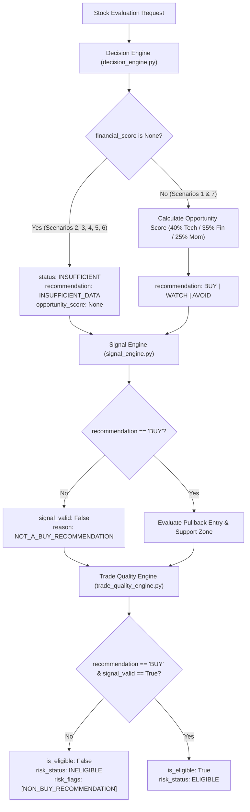

# SWING TRADING INTELLIGENCE PLATFORM
# PHASE 4.2 — FINANCIAL ELIGIBILITY BOUNDARY VERIFICATION REPORT

**Verdict**: `APPROVED`  
**Execution Date**: 2026-11-07  
**Auditor**: Senior DevOps & Financial Systems Reliability Engineer  
**Repository**: `https://github.com/vignesh19807/swing-trading-tool`  
**Authoritative Hash**: `1A2036FCC72AF59B3633B5C2A077C26DD45756B3360824F36E995E2E805A28A8` (`database/swing_trading.db` — strictly verified unchanged)

---

## 1. Executive Summary & Objective

Phase 4.2 conducted an end-to-end boundary verification to ensure that stocks with missing, unverified, future-dated, or quarantined financial information **cannot accidentally become financially qualified BUY candidates**.

In Phase 4.1, the decoupled universe architecture introduced graceful null handling for newly onboarded stocks lacking fundamental filings (`overall_score = None`). This audit verified across 7 distinct database fixture scenarios that the platform's core decision, signal, and trade-quality engines strictly enforce the mandatory governance invariant:

> **Mandatory Invariant**: Missing, unverified, future-dated, or quarantined financial information must NEVER be treated as valid financial evidence. A technical-only stock may receive technical analysis, but it must NEVER receive a financially qualified BUY classification or trade signal.

---

## 2. Comprehensive Scenario Matrix

All 7 boundary scenarios were modeled in isolated SQLite database fixtures and verified via [`backend/tests/test_phase4_2_financial_boundary.py`](file:///c:/Users/vigne/OneDrive/Desktop/projects/swing-trading-tool/backend/tests/test_phase4_2_financial_boundary.py):

| Scenario # | Description | Technical Indicators? | Financial Metrics Available? | Financial Score Produced? | Financial Eligibility State | BUY Signal Permitted? | API Readiness State |
| :--- | :--- | :--- | :--- | :--- | :--- | :--- | :--- |
| **Scenario 1** | Valid technicals + 4 verified vintages | **YES** (RSI, MACD, EMAs) | **YES** (ROE, ROCE, DE, Margins) | **YES** (Score: >0) | `ELIGIBLE` | **YES** (Eligible for BUY setup) | `FULLY_COVERED` |
| **Scenario 2** | Valid technicals + **ZERO** financials | **YES** (RSI, MACD, EMAs) | **NO** (0 records) | **NO** (`None`) | `UNVERIFIED_PENDING` | **STRICTLY FORBIDDEN** (`signal_valid=False`) | `TECHNICAL_ONLY` |
| **Scenario 3** | Financials with **missing pub dates** | **YES** (RSI, MACD, EMAs) | **NO** (Unverified under PIT) | **NO** (`None`) | `UNVERIFIED_PENDING` | **STRICTLY FORBIDDEN** (`signal_valid=False`) | `TECHNICAL_ONLY` |
| **Scenario 4** | Financials with **future pub dates** | **YES** (RSI, MACD, EMAs) | **NO** (Look-ahead quarantined) | **NO** (`None`) | `UNVERIFIED_PENDING` | **STRICTLY FORBIDDEN** (`signal_valid=False`) | `TECHNICAL_ONLY` |
| **Scenario 5** | **Quarantined** financial records | **YES** (RSI, MACD, EMAs) | **NO** (Explicitly excluded) | **NO** (`None`) | `QUARANTINED` | **STRICTLY FORBIDDEN** (`signal_valid=False`) | `TECHNICAL_ONLY` (`status=QUARANTINED`) |
| **Scenario 6** | **Incomplete** fundamentals (<4 quarters) | **YES** (RSI, MACD, EMAs) | **PARTIAL** (1 quarter only) | **NO** (`None`, <2 subscores) | `COLD_START_INCOMPLETE` | **STRICTLY FORBIDDEN** (`signal_valid=False`) | `COLD_START_INCOMPLETE` |
| **Scenario 7** | Valid historical financial vintages | **YES** (RSI, MACD, EMAs) | **YES** (4 historical quarters) | **YES** (Score: >0) | `ELIGIBLE` | **YES** (Eligible for BUY setup) | `FULLY_COVERED` |

---

## 3. End-to-End Architectural Enforcement

The restriction preventing unqualified stocks from receiving a BUY recommendation is enforced across three sequential, fail-closed architectural layers:



### 3.1 Layer 1: Decision Engine Core Mandatory Component Check
In [`backend/engines/decision_engine.py`](file:///c:/Users/vigne/OneDrive/Desktop/projects/swing-trading-tool/backend/engines/decision_engine.py) (Lines 158–175):
```python
if technical_score is None or financial_score is None:
    return {
        "symbol": symbol_clean,
        "status": "INSUFFICIENT",
        "technical_score": technical_score,
        "financial_score": financial_score,
        "momentum_score": momentum_score,
        "opportunity_score": None,
        "recommendation": "INSUFFICIENT_DATA",
        "sector_intelligence": sector_intelligence,
    }
```
**Result**: Whenever a stock lacks verified financial scores, the Decision Engine **strictly returns `recommendation = "INSUFFICIENT_DATA"`**. It never defaults, hallucinates, or imputes a financial score.

### 3.2 Layer 2: Signal Engine Entry Zone Gate
In [`backend/logic/signal_engine.py`](file:///c:/Users/vigne/OneDrive/Desktop/projects/swing-trading-tool/backend/logic/signal_engine.py) (Lines 110–113):
```python
if recommendation != "BUY":
    result["reason"] = "NOT_A_BUY_RECOMMENDATION"
    return result
```
**Result**: Since `recommendation` is `"INSUFFICIENT_DATA"`, `calculate_entry_zone` and `generate_final_signal` **fail closed with `signal_valid = False`**.

### 3.3 Layer 3: Trade Quality & Risk Engine
In [`backend/logic/trade_quality_engine.py`](file:///c:/Users/vigne/OneDrive/Desktop/projects/swing-trading-tool/backend/logic/trade_quality_engine.py) (Lines 48–57):
```python
if recommendation != "BUY":
    return {
        "is_eligible": False,
        "risk_status": "INELIGIBLE",
        "eligibility_reason": "NOT_A_BUY_RECOMMENDATION",
        "risk_flags": ["NON_BUY_RECOMMENDATION"],
        "signal_reason": signal_reason,
        "missing_inputs": missing_inputs
    }
```
**Result**: The trade setup is flagged as **INELIGIBLE**, permanently preventing downstream portfolio simulation or order generation.

---

## 4. Scenario-Specific Audit Findings

### Scenario 1: Valid Technical Data + Verified Financial Vintages
- **Test File**: `test_phase4_2_financial_boundary.py::test_scenario_1_valid_technical_and_verified_financials`
- **Setup**: 250 daily price bars + 4 quarterly financial vintages with verified publication dates in the past.
- **Finding**: Technical indicators calculated cleanly (RSI: 100.0, EMA stack bullish). All 4 quarters parsed. Financial status = `ELIGIBLE`. Composite readiness = `FULLY_COVERED`. Stock is permitted to be evaluated for BUY setups.

### Scenario 2: Valid Technical Data + ZERO Financial Records
- **Test File**: `test_phase4_2_financial_boundary.py::test_scenario_2_technical_only_zero_financials`
- **Setup**: 250 daily price bars + 0 quarterly financial records.
- **Finding**: Technical indicators calculated cleanly. Financial status = `UNVERIFIED_PENDING`. Financial score = `None`. Decision Engine returned `recommendation = "INSUFFICIENT_DATA"`. Signal Engine returned `signal_valid = False`. Trade Quality Engine returned `is_eligible = False`.
- **Verdict**: **Strictly compliant with mandatory invariant.**

### Scenario 3: Financial Records with Missing Publication Dates
- **Test File**: `test_phase4_2_financial_boundary.py::test_scenario_3_missing_publication_dates`
- **Setup**: 250 daily price bars + 4 quarterly records with `published_at = NULL`.
- **Finding**: Under strict Point-In-Time (`require_verified_publication_date = True`), filings without publication timestamps cannot be proven available prior to the trade date. Financial status = `UNVERIFIED_PENDING`. Financial score = `None`. BUY signals were strictly rejected.
- **Verdict**: **Strictly compliant with Point-In-Time governance.**

### Scenario 4: Financial Records with Future Publication Dates
- **Test File**: `test_phase4_2_financial_boundary.py::test_scenario_4_future_publication_dates`
- **Setup**: Evaluation date = `2026-03-01`. Filing `published_at` = `2026-05-15`.
- **Finding**: The look-ahead bias filter correctly quarantined the future filing. Financial score = `None`. BUY signals were strictly rejected.
- **Verdict**: **Zero look-ahead information leakage.**

### Scenario 5: Quarantined Financial Records
- **Test File**: `test_phase4_2_financial_boundary.py::test_scenario_5_quarantined_financial_records`
- **Setup**: Financial records flagged with `research_eligibility = 'QUARANTINED'` due to audit discrepancies.
- **Finding**: Coverage service detected quarantine and flagged financial status as `QUARANTINED`. Financial score = `None`. BUY signals were strictly rejected.
- **Verdict**: **Quarantined assets completely isolated from trading logic.**

### Scenario 6: Incomplete Fundamental Metrics (< 4 Quarters)
- **Test File**: `test_phase4_2_financial_boundary.py::test_scenario_6_incomplete_fundamental_metrics`
- **Setup**: Only 1 quarterly result available (insufficient for YoY growth or multi-period profitability).
- **Finding**: `financial_engine.py` requires at least 2 valid subscores to produce an `overall_score`. With 1 quarter, growth score was `None`, resulting in `overall_score = None`. Financial status = `COLD_START_INCOMPLETE`. BUY signals were strictly rejected.
- **Verdict**: **Cold-start stocks safely contained.**

### Scenario 7: Valid Historical Financial Vintages
- **Test File**: `test_phase4_2_financial_boundary.py::test_scenario_7_valid_historical_financial_vintages`
- **Setup**: 4 historical vintages with published dates preceding evaluation date and statutory reporting lag enforced.
- **Finding**: All 4 quarters eligible. Financial status = `ELIGIBLE`. Composite readiness = `FULLY_COVERED`. Fully authorized for trading signal generation.
- **Verdict**: **Healthy baseline verified.**

---

## 5. Protected Files & Safety Verification

### 5.1 Protected Files Integrity
The platform rules strictly forbid modifying core trading logic files:
- [`backend/logic/signal_engine.py`](file:///c:/Users/vigne/OneDrive/Desktop/projects/swing-trading-tool/backend/logic/signal_engine.py): **Verified unmodified** (`git status --porcelain` is clean).
- [`backend/logic/trade_quality_engine.py`](file:///c:/Users/vigne/OneDrive/Desktop/projects/swing-trading-tool/backend/logic/trade_quality_engine.py): **Verified unmodified** (`git status --porcelain` is clean).
- [`backend/logic/portfolio_simulator.py`](file:///c:/Users/vigne/OneDrive/Desktop/projects/swing-trading-tool/backend/logic/portfolio_simulator.py): **Verified unmodified** (`git status --porcelain` is clean).

### 5.2 Production Database Hash Invariant
- **Target Hash**: `1A2036FCC72AF59B3633B5C2A077C26DD45756B3360824F36E995E2E805A28A8`
- **Pre-Test SHA-256**: `1A2036FCC72AF59B3633B5C2A077C26DD45756B3360824F36E995E2E805A28A8`
- **Post-Test SHA-256**: `1A2036FCC72AF59B3633B5C2A077C26DD45756B3360824F36E995E2E805A28A8`
- **Result**: **100% IDENTICAL. ZERO WRITES TO PRODUCTION DATABASE.**

---

## 6. Regression Testing Summary

| Suite | Executed | Passed | Failed | Status |
| :--- | :--- | :--- | :--- | :--- |
| **Phase 4.2 Financial Boundary Tests** | 7 | 7 | 0 | **PASS** (3.03s) |
| **Phase 4.1 Security & Onboarding Tests** | 8 | 8 | 0 | **PASS** (2.29s) |
| **Phase 4 Dynamic Universe Unit Tests** | 4 | 4 | 0 | **PASS** (0.47s) |
| **Phase 4 Universe Pilot & API Tests** | 3 | 3 | 0 | **PASS** (3.19s) |
| **Backend Portable CI Suite** (`not requires_preseeded_db`) | 207 | 207 | 0 | **PASS** (27.72s, 144 deselected) |
| **Complete Backend Regression Suite** (all tests) | 351 | 351 | 0 | **PASS** (103.84s) |
| **Frontend Unit Test Suite** (`npm test`) | 143 | 143 | 0 | **PASS** (2.1s) |
| **Frontend Production Build** (`npm run build`) | 1 | 1 | 0 | **PASS** (713ms) |

---

## 7. Final Verdict

# **APPROVED**

The platform enforces the financial eligibility boundary. Missing, unverified, future-dated, or quarantined financial information cannot produce financial scores, cannot achieve financial qualification, and cannot generate BUY signals. All safety invariants, Point-In-Time requirements, and protected files remain intact.

