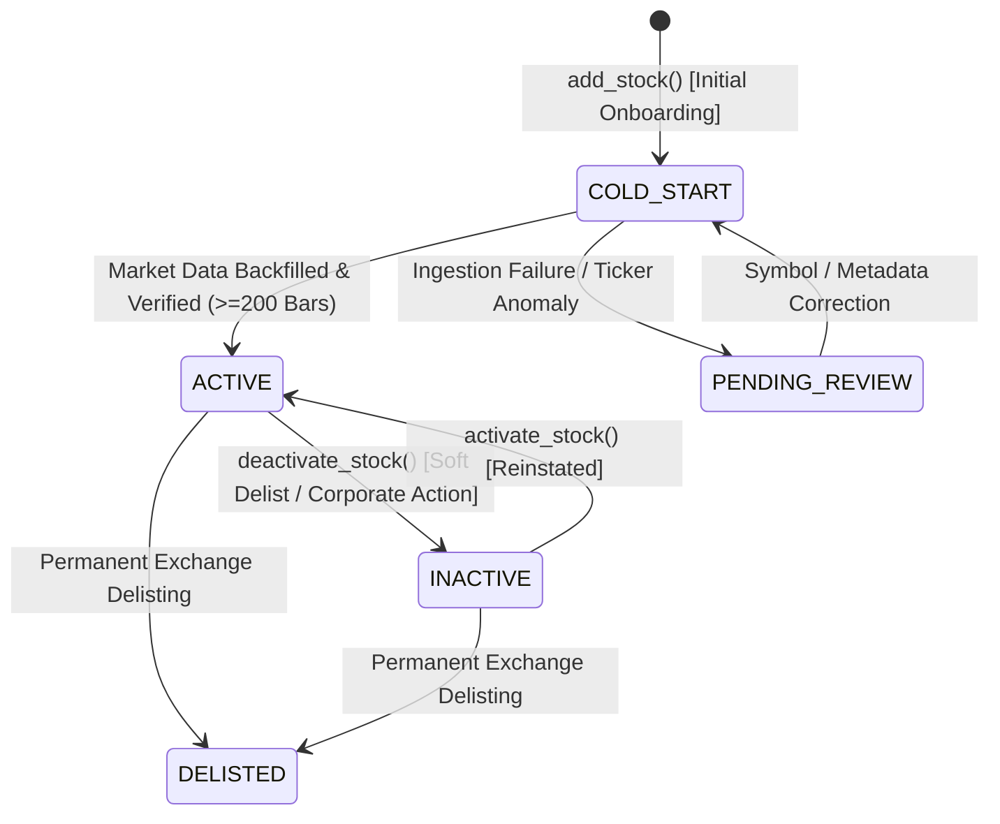

# PHASE 4 — DATABASE-DRIVEN UNIVERSE ARCHITECTURE DESIGN

## 1. Executive Summary & Objective

The Swing Trading Intelligence Platform was originally designed with a dual-representation architecture:
1. A static Python array of 100 stock dictionaries (`backend/data_pipeline/stock_universe.py`) used by batch ingestion scripts (`load_stock_data.py`, `load_financial_data.py`, `run_daily_update.py`).
2. A database table `companies` in SQLite containing 52 active stocks, queried dynamically by `classification_service.py`, `universe_orchestrator.py`, and the FastAPI REST endpoints (`/api/stocks`, `/api/sectors`).

The objective of **Phase 4** is to establish the database as the **single authoritative source of truth** for stock universe membership, lifecycle tracking, and data pipeline orchestration. This design enables scalable expansion toward 300 Indian equities (NSE) while strictly preserving:
- **Zero modification to production database** (`database/swing_trading.db`) during development and CI testing.
- **Strict isolation and protection** of the 4 core financial logic engines (`strategy_engine.py`, `signal_engine.py`, `trade_quality_engine.py`, `portfolio_simulator.py`).
- **Backward compatibility** with legacy queries and existing frontend consumers.

---

## 2. Dynamic Stock Universe Schema Architecture

### 2.1 Extended `companies` Table

The existing `companies` table structure:
```sql
CREATE TABLE companies (
    id INTEGER PRIMARY KEY AUTOINCREMENT,
    symbol TEXT NOT NULL UNIQUE,
    company_name TEXT NOT NULL,
    sector TEXT NOT NULL,
    industry TEXT,
    exchange TEXT DEFAULT 'NSE',
    sector_id INTEGER REFERENCES sectors(id),
    industry_id INTEGER REFERENCES industries(id)
);
```

To support dynamic lifecycle management, metadata tracking, and soft deactivations without data loss, the table is extended with six backward-compatible columns:

| Column | Type | Constraints / Defaults | Description |
| :--- | :--- | :--- | :--- |
| `is_active` | `INTEGER` | `NOT NULL DEFAULT 1` | Fast boolean flag (`1` = active, `0` = inactive) for pipeline filtering. |
| `status` | `TEXT` | `NOT NULL DEFAULT 'ACTIVE'` | Descriptive lifecycle state (`ACTIVE`, `INACTIVE`, `COLD_START`, `PENDING_REVIEW`, `DELISTED`). |
| `listing_date` | `TEXT` | `NULL` | ISO date string (`YYYY-MM-DD`) of exchange listing. |
| `created_at` | `TEXT` | `NULL` | ISO-8601 UTC timestamp of initial universe onboarding. |
| `updated_at` | `TEXT` | `NULL` | ISO-8601 UTC timestamp of last metadata or state modification. |
| `source` | `TEXT` | `DEFAULT 'INITIAL_UNIVERSE'` | Onboarding origin (`INITIAL_UNIVERSE`, `MANUAL_ONBOARDING`, `INDEX_REBALANCE`, etc.). |

#### Indexing Strategy:
- `CREATE INDEX IF NOT EXISTS idx_companies_is_active ON companies(is_active);`
- `CREATE INDEX IF NOT EXISTS idx_companies_status ON companies(status);`
- Composite queries on `(is_active, sector_id)` leverage existing indexes alongside `is_active`.

---

### 2.2 Universe Audit Log Table (`universe_audit_log`)

All structural modifications, onboarding actions, activations, and deactivations are recorded in an append-only audit trail:

```sql
CREATE TABLE IF NOT EXISTS universe_audit_log (
    id INTEGER PRIMARY KEY AUTOINCREMENT,
    symbol TEXT NOT NULL,
    action TEXT NOT NULL,                -- 'ADD', 'ACTIVATE', 'DEACTIVATE', 'UPDATE_METADATA', 'STATUS_CHANGE'
    old_values_json TEXT,                -- JSON snapshot of record prior to action
    new_values_json TEXT,                -- JSON snapshot of record post action
    initiated_by TEXT NOT NULL DEFAULT 'SYSTEM', -- Operator username, API client, or pipeline daemon
    notes TEXT,                          -- Reason for lifecycle change or corporate action context
    timestamp TEXT NOT NULL              -- ISO-8601 UTC timestamp
);

CREATE INDEX IF NOT EXISTS idx_universe_audit_symbol ON universe_audit_log(symbol);
CREATE INDEX IF NOT EXISTS idx_universe_audit_action ON universe_audit_log(action);
CREATE INDEX IF NOT EXISTS idx_universe_audit_timestamp ON universe_audit_log(timestamp);
```

---

## 3. Stock Lifecycle State Machine

The stock lifecycle decouples administrative inclusion from analytical and trading readiness:



### Lifecycle State Definitions:
1. **`COLD_START`**: The stock has been registered in the database, but historical OHLCV data and technical indicators are either pending ingestion or insufficient (<200 trading days). Not yet eligible for trading signals.
2. **`ACTIVE`**: The stock has full market data coverage (>= 200 bars), active technical indicators, and participates in universe ranking and screening. (If financial vintages are missing, the Decision Engine operates under strict Cold-Start Graceful Fallback mode without fabricating scores).
3. **`INACTIVE`**: The stock is soft-disabled from daily data fetching and signal generation. **Crucially: All historical daily prices, technical indicators, and quarterly financial records are preserved intact.**
4. **`PENDING_REVIEW`**: Discrepancies detected during automated ingestion (e.g., symbol remapped by NSE, corporate merger, price anomalies).
5. **`DELISTED`**: Permanently retired from trading. Preserved for backtest historical fidelity.

---

## 4. Architectural Decoupling & Unified Service Interface

### 4.1 Single Source of Truth: `stock_universe_service.py`

Previously, pipelines imported `STOCK_UNIVERSE` directly from `stock_universe.py`. Under the dynamic architecture:
- `stock_universe_service.py` provides clean, database-backed query methods.
- A fallback layer ensures backward compatibility with databases that have not yet executed `migrate_universe_schema`.

#### Core Methods:
- `get_active_universe(db_path=None) -> List[Dict]`:
  Returns all stocks where `is_active = 1` and `status = 'ACTIVE'`, ordered by symbol.
- `get_universe_stock(symbol: str, db_path=None) -> Optional[Dict]`:
  Fetches full metadata and status for a single symbol.
- `get_universe_count(db_path=None) -> Dict[str, int]`:
  Returns `{"active": int, "inactive": int, "total": int, "cold_start": int}`.
- `get_all_universe_stocks(db_path=None, status=None, limit=None, offset=None) -> List[Dict]`:
  Paginated listing supporting administrative and dashboard views.

---

## 5. Non-Destructive Migration Strategy

The migration implementation in `backend/database/migrate_universe_schema.py` satisfies four strict criteria:
1. **Idempotence**: Inspects `PRAGMA table_info(companies)` before executing `ALTER TABLE ADD COLUMN`. Safe to execute repeatedly.
2. **Data Preservation**: Existing 52 companies default to `is_active = 1`, `status = 'ACTIVE'`, and `source = 'INITIAL_UNIVERSE'`. No data is dropped or overwritten.
3. **Foreign Key Integrity**: Foreign keys `sector_id` and `industry_id` are unaffected.
4. **Production Isolation**: Can target any database file via `db_path`. Production DB `database/swing_trading.db` is never altered during tests or CI.

---

## 6. Verification and Test Strategy

Testing dynamic universe management requires:
1. **Schema Migration Tests**: Validating `migrate_universe_schema` on in-memory and temporary SQLite databases.
2. **Service Fallback Tests**: Verifying graceful operation on legacy databases lacking `is_active`.
3. **Lifecycle Tests**: Validating `add_stock`, `activate_stock`, `deactivate_stock`, and confirming no historical price/financial data is ever deleted.
4. **Audit Trail Tests**: Ensuring every lifecycle change creates an immutable `universe_audit_log` entry with before/after state.
5. **Production Hash Invariant**: Verifying that `database/swing_trading.db` SHA-256 remains strictly `1A2036FCC72AF59B3633B5C2A077C26DD45756B3360824F36E995E2E805A28A8`.

