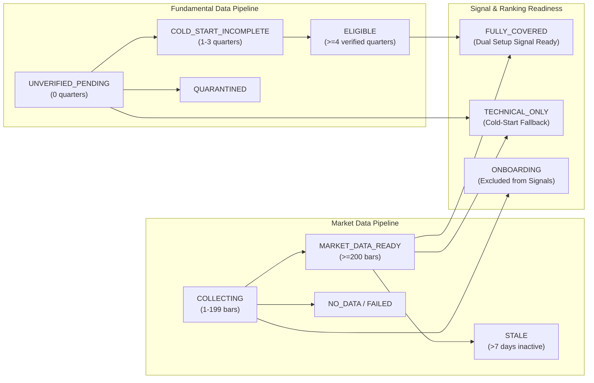

# PHASE 4 — DATA COVERAGE ARCHITECTURE & DECOUPLED LIFECYCLE DESIGN

## 1. Executive Summary

A critical insight from the Phase 1 and Phase 2 audits is that **market data (OHLCV prices) and financial fundamentals (quarterly filings) have fundamentally different cadences, verification requirements, and availability profiles**:
- **Market Data**: Continuous, highly accessible via daily market feeds (yfinance), verifiable via standard mathematical invariants (High >= Low, Volume >= 0). 200 trading days can be backfilled immediately upon onboarding.
- **Financial Fundamentals**: Discrete (quarterly), subject to statutory lag (SEBI 45-day window), requiring authentic exchange verification (NSE/BSE filings, OCR verification, immutable point-in-time publication dates). Newly listed or newly onboarded stocks cannot immediately possess 4 verified historical vintages unless audited.

Prior to Phase 4, the platform risked a failure-closed state or starvation when expanding the universe because the scoring pipeline assumed complete financial coverage. The Phase 4 **Decoupled Coverage Architecture** resolves this by separating Market Data Readiness from Fundamental Eligibility.

---

## 2. Decoupled State Model

---

## 3. Dimensional Definitions

### 3.1 Market Data Dimension

| State | Condition | Capabilities / Permissions |
| :--- | :--- | :--- |
| **`NO_DATA`** | 0 daily price bars in `daily_prices` | Stock is registered but completely inactive. |
| **`COLLECTING`** | 1 to 199 daily price bars | Accumulating history. Ineligible for EMA 200 or technical scoring. |
| **`MARKET_DATA_READY`** | >= 200 daily price bars, indicators computed | Eligible for technical screening, momentum calculation, and technical ranking. |
| **`STALE`** | Latest price bar is > 7 calendar days old | Warning badge displayed; daily update pipeline flags for re-fetch. |

### 3.2 Fundamental Data Dimension

| State | Condition | Capabilities / Permissions |
| :--- | :--- | :--- |
| **`UNVERIFIED_PENDING`** | 0 verified quarterly vintages in database | Fundamental engine operates in cold-start fallback. No fake scores fabricated. |
| **`COLD_START_INCOMPLETE`** | 1 to 3 verified quarterly vintages | Partial historical baseline. Fundamental trend calculations withheld. |
| **`ELIGIBLE`** | >= 4 verified quarterly vintages | Fully qualified for financial scoring, growth metrics, and balance sheet health. |
| **`QUARANTINED`** | Data integrity anomaly detected | Fundamental data excluded from scoring until auditor remediation. |

---

## 4. Cold-Start Graceful Fallback in the Decision Engine

### The Strict Cold-Start Invariants:
1. **Never Fabricate Data**: Under no circumstance should default financial scores (e.g., `50.0`, `100.0`, or sector averages) be imputed or invented for an unverified stock.
2. **Graceful Null Handling**: When a stock is `TECHNICAL_ONLY` (`MARKET_DATA_READY` but `UNVERIFIED_PENDING`):
   - `financial_score` returns `None` / `null`.
   - `overall_score` gracefully reflects available components (or reports technical score with an explicit disclaimer).
   - Downstream UI renders a clear badge: `Technical Only (Awaiting Fundamentals)`.
3. **No Failure-Closed Crashes**: Ingestion, ranking, and API responses never crash or return HTTP 500 when financial records are absent for a stock.

---

## 5. Coverage Monitoring Service (`universe_coverage_service.py`)

The unified coverage service exposes two core interfaces:
1. **`get_stock_coverage(symbol)`**: Granular per-stock report detailing:
   - Total daily bars, date span, and staleness flag.
   - Total technical indicator records.
   - Total quarterly vintages and latest fiscal quarter.
   - Composite readiness state (`FULLY_COVERED`, `TECHNICAL_ONLY`, `ONBOARDING`).
2. **`get_universe_coverage_summary()`**: Universe-wide aggregate breakdown for system monitoring and dashboard health widgets.

---

## 6. Freshness and Staleness Thresholds

- **Trading Days Verification**: Daily updates run post-market (16:00 IST).
- **Staleness Threshold**: 7 calendar days (to account for extended market holidays and weekends).
- **Automated Alerts**: If an active stock's latest date lags by > 7 days, its status automatically switches to `STALE`.

