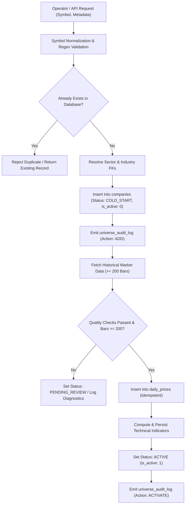

# PHASE 4 — ONBOARDING PIPELINE SPECIFICATION

## 1. Executive Summary

This document specifies the architecture, operation, and validation criteria for the automated onboarding of Indian equity tickers into the Swing Trading Intelligence Platform. 

Previously, adding a stock required manually modifying a hardcoded 100-stock array in `backend/data_pipeline/stock_universe.py` and running whole-universe ETL batches. Under the Phase 4 architecture, onboarding is database-driven, modular, verifiable, and supports incremental onboarding without affecting existing universe stocks.

---

## 2. Onboarding Lifecycle & Architecture

The onboarding pipeline progresses through distinct, verifiable stages:

---

## 3. Detailed Workflow Steps

### Step 1: Symbol Normalization & Validation
- **Input**: `symbol`, `company_name`, `sector`, `industry`, `exchange`.
- **Validation**:
  - Whitespace stripped, converted to uppercase.
  - Regex enforcement: `^[A-Z0-9&-]{1,20}$`.
  - Disallow `.NS` / `.BO` exchange suffixes in the symbol column (exchange is stored separately).
  - Validates non-empty `company_name` and `sector`.

### Step 2: Database Registration (`COLD_START`)
- Checks `companies` table for symbol collisions.
- Looks up or auto-creates foreign key references in `sectors` and `industries`.
- Inserts new row with:
  - `is_active = 0`
  - `status = 'COLD_START'`
  - `source = 'MANUAL_ONBOARDING'` (or caller-supplied origin)
  - `created_at` & `updated_at` timestamps (ISO-8601 UTC).
- Logs initial creation to `universe_audit_log`.

### Step 3: Market Data Acquisition & Quality Gate
- Downloads 2 years of daily OHLCV data using the market data provider (`yfinance` or test provider).
- Quality Gate:
  1. No empty datasets.
  2. Required columns: `date, open, high, low, close, volume`.
  3. No `NaN` values in `open, high, low, close`.
  4. High >= Low for every observation.
  5. Close > 0 and Volume >= 0 for all rows.
  6. **Minimum 200 trading days**: Essential for calculating 200-day exponential moving average (`ema200`) and standard technical scoring.

### Step 4: Technical Indicator Computation
- Persists bars into `daily_prices` with `INSERT OR IGNORE`.
- Invokes `save_technical_indicators(symbol)`:
  - RSI (14-period)
  - MACD, Signal, Histogram (12, 26, 9)
  - EMA 20, EMA 50, EMA 200
  - ATR 14
  - Technical composite score
- Persists computed metrics into `technical_indicators`.

### Step 5: Activation & Audit
- Once technical indicators are successfully persisted and bar threshold is met:
  - Updates `companies`: `is_active = 1`, `status = 'ACTIVE'`, `updated_at = now()`.
  - Records `ACTIVATE` event in `universe_audit_log`.
  - The stock is immediately available to `get_active_universe()` and active pipeline runs.

---

## 4. Pipeline Decoupling Strategy

All ingestion runners have been refactored to query `stock_universe_service.get_active_universe()` as their primary source of truth:

1. **`run_technical_pipeline.py`**:
   - Queries `get_active_universe()`.
   - Iterates only over verified active stocks in the database.
   - Falls back to `STOCK_UNIVERSE` if the database is uninitialized.

2. **`run_daily_update.py`**:
   - Queries `get_active_universe()`.
   - Fetches and updates price bars and indicators for active universe members.
   - Preserves diagnostic coverage reporting.

3. **`load_stock_data.py` & `load_financial_data.py`**:
   - Dynamically resolves active stocks via `_get_target_universe()`.
   - Gracefully handles cold environments without code alterations.

---

## 5. Failure Modes, Anomaly Isolation & Recovery

| Failure Mode | Detection | System Action | Recovery Path |
| :--- | :--- | :--- | :--- |
| **Invalid Ticker Format** | Regex mismatch or exchange suffix present | `ValueError` raised immediately; DB untouched | User/caller corrects symbol format |
| **Symbol Collision** | `companies.symbol UNIQUE` constraint | Rejection with detailed conflict message | Verify existing record status |
| **Provider Timeout / Missing Data** | Empty dataframe returned from provider | Stock remains in `COLD_START` or moved to `PENDING_REVIEW` | Retry via `batch_onboard_cold_start_stocks()` |
| **Insufficient History (<200 bars)** | Bar count validation fails | Stock retained in `COLD_START` with diagnostic reason | Await trading tenure or approve with reduced window |
| **Data Corruption (High < Low)** | Quality gate validation fails | Stock set to `PENDING_REVIEW`; audit log note | Inspect raw provider data or report ticker issue |

---

## 6. Audit Trail Compliance

Every state change produces an immutable row in `universe_audit_log`:
- `symbol`: Ticker symbol.
- `action`: `ADD`, `ACTIVATE`, `DEACTIVATE`, `STATUS_CHANGE`.
- `old_values_json`: Snapshot of previous record state.
- `new_values_json`: Snapshot of updated record state.
- `initiated_by`: Originating operator, API client, or pipeline daemon.
- `notes`: Human-readable context or diagnostic explanation.
- `timestamp`: ISO-8601 UTC timestamp.

